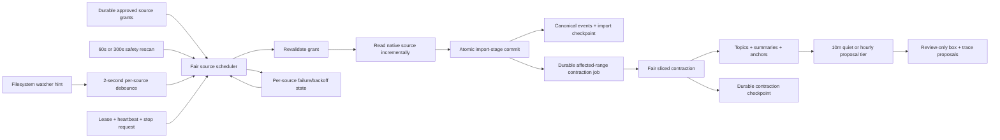

# Phase 4 Research: Continuous Local Daemon

## User Constraints (from CONTEXT.md)

### Locked decisions

- **D-01 — Explicit enablement:** Auto-start at login only after the user explicitly enables it; retain a foreground `run` path. [VERIFIED: codebase]
- **D-02 — Platform boundary:** Build a portable daemon core and a macOS LaunchAgent adapter only. Windows and Linux service adapters are deferred. [VERIFIED: codebase]
- **D-03 — Ownership:** One daemon owns one memory database as its single background writer. It schedules every person in that database independently, although one person is the normal installation. [VERIFIED: codebase]
- **D-04 — Lifecycle controls:** Ship `run`, `start`, `stop`, `restart`, `status`, and `once`. Status reports process identity, heartbeat, and last successful scan; stop is graceful. [VERIFIED: codebase]
- **D-05 — Rescan correctness:** Filesystem watchers are latency hints, not correctness. Watcher changes should become visible within seconds, and approved sources must receive a periodic incremental rescan at least once per minute on external power. [VERIFIED: codebase]
- **D-06 — Burst coalescing:** Coalesce watcher changes for about two seconds and schedule one source scan per burst. [VERIFIED: codebase]
- **D-07 — Battery policy:** Watcher wakeups remain immediate on battery; only the safety rescan changes from one minute to five minutes, returning to one minute on external power. [VERIFIED: codebase]
- **D-08 — Fair queue:** Use one fair single-writer queue. Watcher jobs receive prompt priority, but round-robin fairness must prevent starvation. [VERIFIED: codebase]
- **D-09 — Failure isolation:** A failed source must not stop other sources. Retry it with bounded exponential backoff and restore normal scheduling after success. [VERIFIED: codebase]
- **D-10 — Safe diagnostics:** Persist source identity, error category, attempt count, and timestamps without conversation content. Mark a source degraded after three consecutive failures or fifteen minutes, and emit only one macOS notification for that degraded episode. [VERIFIED: codebase]
- **D-11 — Durable stages:** Import and contraction are separate durable stages. A stage checkpoint advances only with its committed writes; restart replays the earliest incomplete stage idempotently. [VERIFIED: codebase]
- **D-12 — Grant enforcement:** Revalidate the durable grant before opening a source and at each stage boundary. Revocation aborts before further writes commit. Rotation and temporary absence resume from durable source identity; an incomplete record never advances its import checkpoint. Deletion remains a separate exact-confirmation action. [VERIFIED: codebase]
- **D-13 — Non-blocking contraction:** A committed import batch enqueues only the new canonical-event range. Source scanning does not wait for summarization or proposal generation. [VERIFIED: codebase]
- **D-14 — Bounded late-event rewind:** An event inserted earlier in canonical order rewinds from the earliest affected topic span. Recompute and supersede only changed downstream objects; never append the event out of order or rebuild unaffected earlier history. [VERIFIED: codebase]
- **D-15 — Yielding slices:** Contraction uses configurable, interactive-friendly slices, defaulting to about two seconds or 250 events, and resumes from a durable checkpoint. [VERIFIED: codebase]
- **D-16 — Two-tier derivation:** Topics, summaries, and anchors update immediately. Box and trace proposals run after ten quiet minutes or at least hourly, and are never auto-approved. [VERIFIED: codebase]

### Agent discretion

The planner may choose module/class boundaries, SQLite schema names, LaunchAgent label and plist location, CLI output schema, PID/lease representation, backoff cap and jitter, macOS power and notification adapters, fixture shapes, and exact fairness weights/data structures, provided the locked behavior is testable. [VERIFIED: codebase]

### Deferred scope

Windows/Linux service installers, Phase 5 MCP access, Phase 6 multi-device synchronization, and Phase 7 onboarding/packaging UI are explicitly outside Phase 4. [VERIFIED: codebase]

## Summary and Primary Recommendation

Implement Phase 4 as a deterministic daemon orchestration layer around the existing approved-source importers and historical contraction pipeline, with all correctness state in the existing memory SQLite database. Keep watcher, power, notification, signal, clock, and LaunchAgent behavior behind injected adapters so the core is portable and tests use no real histories or OS services. [VERIFIED: codebase]

The critical first step is not the scheduler; it is a durable storage contract for atomic import-stage commits, contraction jobs/checkpoints, source health, and the daemon lease/heartbeat. Current canonical-event, turn, quarantine, import-checkpoint, summary, anchor, and bootstrap-checkpoint writes are separate store calls, and `SqliteStore` exposes no transaction boundary. The current replay is idempotent because canonical IDs are deterministic, but it does not yet prove D-11's checkpoint-and-writes atomicity or D-12's grant check at commit. [VERIFIED: codebase]

Recommended implementation order:

1. Add daemon domain schemas and domain-specific atomic storage operations, including compare-against-current-grant semantics at the commit boundary. [VERIFIED: codebase]
2. Extract reusable approved-source runners from the import command wrappers; daemon scans must consume existing durable grants, not create or silently reapprove grants. [VERIFIED: codebase]
3. Add a durable fair scheduler and source-state machine with injected clock/timers/power/watcher/notification adapters. [ASSUMED]
4. Replace `HistoricalBootstrapper`'s full-prefix reset path with a resumable range contraction engine, while leaving the existing one-shot command as a compatibility facade. [VERIFIED: codebase]
5. Add CLI lifecycle controls and the macOS LaunchAgent adapter last, after `run` and `once` are independently testable. [ASSUMED]

No external package is required. Node already supplies filesystem watching, timers, process signals, child processes, crypto, paths, and the SQLite API used by this project; Zod and Vitest are already installed. [VERIFIED: codebase]

## Phase Requirements

| Requirement | What the planner must deliver | Proof boundary |
|---|---|---|
| REQ-017 — Local daemon | A portable loop enumerates **approved** durable grants, schedules each source/person, imports increments, and records health. A macOS adapter enables login startup only after explicit `start`/enablement. [VERIFIED: codebase] | Synthetic four-source `once` and repeated foreground-loop tests; no real history roots. |
| REQ-018 — Correctness by rescan | Watchers enqueue prompt work, while a separately scheduled safety rescan covers every approved source at 60 seconds on power and 300 seconds on battery. [VERIFIED: codebase] | Fake clock/watcher/power adapter proves lost watcher events are recovered by rescan. |
| REQ-019 — Idempotent restart | Deterministic importer IDs plus atomic stage checkpoints/jobs make repeated scans and crash replay converge without duplicate events, turns, summaries, anchors, or proposals. Existing importers already use deterministic event/checkpoint identity and complete-record offsets/high-water marks. [VERIFIED: codebase] | Fault-injection tests at every import/contraction boundary, then restart and compare normalized DB state. |
| REQ-020 — Offline operation | All correctness paths use local source files/databases, local SQLite, and the deterministic summarizer. External LLM behavior remains optional and adapter-gated. [VERIFIED: codebase] | Tests run with network unavailable/unconfigured and no OpenRouter credentials. |
| REQ-021 — Local authority | Lease, health, jobs, checkpoints, canonical events, and derivations are read from/written to the local memory database; watchers and LaunchAgent state are advisory operational inputs, not authority. [VERIFIED: codebase] | Restart from database state with empty in-memory scheduler and prove work resumes. |
| REQ-022 — Incremental contraction | Appends process only new ranges; late events rewind from the earliest affected topic span; slices stop at 250 events or about two seconds; box/trace proposal work is quiet-period/hourly and review-only. [VERIFIED: codebase] | Append, late insertion, unchanged-prefix, slice-yield, and quiet/hourly proposal tests prove unaffected prefix objects retain identity/state. |

## Project Constraints from AGENTS.md

- Enforce person, workspace, thread, and retrieval-scope isolation. Shared personal storage must not permit unrelated sensitive contexts to leak. [VERIFIED: codebase]
- Treat memory as assistive, preserve provenance, and prefer current source material and explicit approvals over summaries. [VERIFIED: codebase]
- Never auto-approve box, trace, sleep-review, or other review-gated proposals. [VERIFIED: codebase]
- Never durably store raw secrets, credentials, private keys, or client documents; quarantine and diagnostics must remain bounded and redacted. [VERIFIED: codebase]
- Native histories are read-only. The daemon must not modify, move, lock for writing, or delete a source history. [VERIFIED: codebase]
- Deterministic/local tests cannot require OpenRouter or any external model. [VERIFIED: codebase]
- Keep packing/contraction deterministic and test ordering, limits, and fallbacks. [VERIFIED: codebase]
- Preserve unrelated dirty work and treat `example/` as reference material. This worktree was already substantially dirty before this research file was added. [VERIFIED: codebase]
- Read ADRs 0042–0046 as the controlling import, lifecycle, quarantine, provenance, person, and scope contracts. [VERIFIED: codebase]

## Architectural Responsibility Map

| Responsibility | Recommended seam | Existing code to reuse or change |
|---|---|---|
| Daemon schemas | `src/daemon/types.ts` | Follow Zod schema/type style in `src/bootstrap/types.ts` and `src/imports/types.ts`. [VERIFIED: codebase] |
| Durable orchestration state | Extend `MemoryStore`, `SqliteStore`, and `InMemoryStore` with daemon lease, per-source health, scan receipts, contraction jobs, and contraction checkpoints | Current store has grants/import/bootstrap state but no daemon state or public transaction. [VERIFIED: codebase] |
| Atomic stage commits | Domain-specific store methods such as `commitImportBatch` and `commitContractionSlice`, implemented as one SQLite transaction and emulated atomically in memory | Current importers call `MemoryService.ingestEvent()` repeatedly, then save the file/row checkpoint separately. [VERIFIED: codebase] |
| Approved-source dispatch | `src/daemon/approved-source-runner.ts` | Extract/refactor discovery/import dispatch from `history-import-command.ts` and `codex-import-command.ts`; do not call command paths that invoke `approve()`. [VERIFIED: codebase] |
| Scheduling/fairness | `src/daemon/scheduler.ts` | New portable queue; inject clock and wakeup source. [ASSUMED] |
| Watch acceleration | `src/daemon/watch-controller.ts` | Use an injected watcher factory; map events to candidate IDs, debounce per source, and always retain periodic rescans. [ASSUMED] |
| Source recovery/health | `src/daemon/source-state.ts` | New state machine persisted by candidate/person; diagnostics contain identifiers/categories/counts/times only. [ASSUMED] |
| Incremental contraction | `src/daemon/contraction-runner.ts` plus a refactored `HistoricalBootstrapper` | Reuse `TopicMonitor`, deterministic summarizer, `AnchorDetector`, `BoxAssigner`, and `SleepReviewer`; replace full-prefix reset for late events. [VERIFIED: codebase] |
| Quiet proposal tier | `src/daemon/proposal-scheduler.ts` | Reuse `SleepReviewer.proposeBoxes/proposeTraces`; keep proposals in proposed state. [VERIFIED: codebase] |
| Core process | `src/daemon/daemon.ts` | Own store, lease, heartbeat, graceful abort, queue, watcher, and scan/contraction loops. [ASSUMED] |
| CLI | `src/daemon/daemon-command.ts` | Add `memory:daemon` or explicit script aliases for `run/start/stop/restart/status/once`; extend `memory:status` rather than creating a competing health authority. [VERIFIED: codebase] |
| macOS integration | `src/daemon/macos/launch-agent.ts`, `power-source.ts`, `notification.ts` | OS-specific adapters stay outside domain/storage/import modules. [ASSUMED] |

Recommended durable records, exact names discretionary:

- `daemon_instance`: database identity, owner token/PID, started time, heartbeat, stop-request state, last successful global scan. [ASSUMED]
- `daemon_source_state`: person/grant/candidate identity, next due time, last attempt/success, consecutive failures, first failure, degraded/notified episode, and sanitized error category. [ASSUMED]
- `daemon_scan_receipt`: durable import stage identity and new event range/order keys, or fold this into a contraction job if one record can carry both states. [ASSUMED]
- `contraction_job`: person, earliest affected canonical order key/event ID, latest imported event ID, state/attempts, and created/updated times. Multiple pending jobs for one person should merge to the earliest start and latest end. [ASSUMED]
- `contraction_checkpoint`: processor version, job/generation, next canonical order key/index, restored topic state, slice count, and last completed immediate/proposal stage. [ASSUMED]



## Standard Stack

- **Runtime:** TypeScript ESM executed with existing `tsx`; production type safety through existing `tsc --noEmit`. [VERIFIED: codebase]
- **Validation:** Existing Zod dependency for CLI/config/durable-record schemas. [VERIFIED: codebase]
- **Storage:** Existing synchronous `node:sqlite`-backed `SqliteStore`, with matching `InMemoryStore` behavior for unit tests. [VERIFIED: codebase]
- **Testing:** Existing Vitest 2 setup, fake clocks, temporary directories, and synthetic JSONL/SQLite sources. [VERIFIED: codebase]
- **Portable OS primitives:** Built-in `node:fs`/`fs/promises`, timers, `AbortController`, process signals, `node:child_process`, `node:path`, and `node:crypto`. [ASSUMED]
- **macOS service primitives:** Wrap installed `/bin/launchctl`, `/usr/bin/pmset`, and `/usr/bin/osascript` behind adapters; do not invoke them in unit tests. Their presence was verified on this development host, but exact output and service behavior must be capability-checked and treated as unavailable on non-macOS hosts. [VERIFIED: codebase]
- **Dependencies:** Add no package for queues, debounce, watchers, process management, power checks, notifications, or backoff unless implementation proves a built-in primitive cannot meet a locked decision. [ASSUMED]

## Architecture Patterns and Concrete Existing Code Seams

### 1. Durable grants are the daemon's source registry

`SourceLifecycleService.assertApproved(personId, candidateId)` is the existing authorization check. Grants retain application, format, locator, profile, scope, and state, and scope cannot silently change during reapproval. The daemon should enumerate approved grants, reconstruct the importer approval from each grant, and assert the same grant again inside each atomic stage commit. [VERIFIED: codebase]

Do not route scans through current command functions unchanged: both import command paths discover a candidate and call `lifecycle.approve()` before import. That is appropriate for an explicit user command but would let background work reapprove a revoked source. Extract shared discovery/dispatch services and give daemon runners a `SourceGrant`, not CLI flags. [VERIFIED: codebase]

### 2. Preserve importer resume semantics while tightening commit boundaries

Codex, Claude Code, and OpenClaw use stable candidate/resource checkpoint IDs, device/inode file identity, parser version, byte offset, record index, and only consume newline-complete records. Hermes opens the native database read-only and uses device/inode identity plus a monotonically increasing row high-water mark. All canonical event IDs derive deterministically from person/source/session/native-event identity. [VERIFIED: codebase]

The importers currently advance an in-memory `committedOffset` before all durable writes for that record have been grouped into one transaction, then persist the checkpoint after the entire resource scan. A crash replays idempotently, but Phase 4 should commit bounded record batches atomically: expected-approved-grant check, source/person upserts, canonical events, native turns, quarantine transitions, import checkpoint, and contraction-job merge. A partial trailing JSONL record stays before the checkpoint exactly as today. [VERIFIED: codebase]

Return an `ImportBatchReceipt` containing **new or materially changed** canonical IDs and their canonical order keys. Importer counters alone cannot drive D-13/D-14 because `messagesProcessed` includes deterministic upserts and does not identify whether a late event changed the ordered timeline. [VERIFIED: codebase]

### 3. Use one durable queue with two logical priorities

A simple deterministic scheduler is sufficient: maintain a FIFO prompt queue for debounced watcher wakes plus a round-robin due-source ring. After a small configured prompt burst (for example, one prompt job), force one due round-robin job when present. Deduplicate by `(personId, candidateId, stage)` so repeated watcher events only advance urgency. Persist next-due/backoff/source-health, but reconstruct ephemeral heap/ring indexes at startup from durable records. Exact weights remain discretionary and must be asserted by starvation tests. [ASSUMED]

Contraction uses the same single writer but separate durable jobs. A source scan ends after its import transaction enqueues/merges a job. The main loop then selects import or contraction work fairly; it must never await the whole contraction pipeline inside the source scan. [ASSUMED]

### 4. Model failures as per-source episodes

Persist failure count, first/last failure, next attempt, category, degraded-at, and notification-sent-at. Use a bounded exponential schedule with deterministic injectable jitter; reset the episode after success. Do not persist thrown messages, paths beyond the already-approved source identity, record bodies, or conversation content. Treat temporary absence/rotation as a source failure category that retries from the candidate/checkpoint identity rather than deleting state. [ASSUMED]

Degraded transition is `consecutiveFailures >= 3 OR now - firstFailureAt >= 15 minutes`. Notification fires only on the transition into one degraded episode; a later success clears the episode so a genuinely new episode may notify once. [VERIFIED: codebase]

### 5. Replace prefix reset with affected-range generations

`HistoricalBootstrapper` currently checkpoints processed count, last event ID, rolling prefix hash, and active topic. Appends resume correctly, while any changed processed prefix restarts at event zero and supersedes unproduced old summaries. This is the exact seam D-14 replaces. [VERIFIED: codebase]

Recommended late-event algorithm:

1. Compute the earliest order key among new/changed canonical events using the store's existing order: `occurredAt`, `nativeSequence`, then `id`. [VERIFIED: codebase]
2. Locate the active historical topic span/summary intersecting that key; rewind to that span's first canonical event. If none intersects, rewind from the inserted event. [ASSUMED]
3. Preserve all completed derivations strictly before the rewind boundary. Rebuild compatibility turn sequence and topic state only from the boundary onward; a small look-behind snapshot may be stored if `TopicMonitor` needs restored context. [ASSUMED]
4. Build a new durable contraction generation in slices. Compare old and new summary provenance/fingerprint before superseding. If source IDs, scope union, summary text/model/prompt version, or dependency set changed, supersede affected boxes/traces/proposals and regenerate review-only proposals later; unchanged objects remain untouched. [ASSUMED]
5. Atomically publish each completed slice and its checkpoint. A crash resumes the same generation from the last published slice. [ASSUMED]

Current summaries retain canonical event IDs and scope unions, anchors retain canonical event IDs, and source deletion already supersedes summaries plus dependent boxes/proposals/traces. Reuse that dependency traversal, but centralize it so deletion and late-event rewind share one fail-closed invalidation service. [VERIFIED: codebase]

### 6. Separate immediate and quiet derivation tiers

Refactor contraction so topic observation, summary persistence, and anchor detection are the immediate stage. Do not call `SleepReviewer.proposeBoxes()` and `proposeTraces()` on every slice; current `HistoricalBootstrapper.bootstrap()` calls both at the end of every non-noop run. Instead persist `lastImmediateDerivationAt`, `lastProposalRunAt`, and the latest person activity time. Run proposal generation when quiet for ten minutes, and force it at least hourly while pending changed summaries exist. Proposal state remains `proposed`. [VERIFIED: codebase]

### 7. Lease and lifecycle controls

Use database-backed lease/heartbeat state as process status authority and a PID only as supporting process identity. `run` acquires the lease, starts heartbeat, installs graceful signal handling, and refuses a live unexpired owner. `once` acquires the same lease, performs one due rescan pass plus bounded queued contraction work, reports remaining work, and exits. `stop` records a durable stop request and optionally signals the recorded PID; the loop finishes/rolls back the current atomic stage, checkpoints, releases the lease, and exits. [ASSUMED]

`start` explicitly writes/loads a LaunchAgent configuration and starts it; `restart` is graceful stop followed by start; `status` combines LaunchAgent capability/state with the database lease, heartbeat, last successful scan, source degradation, and queued contraction counts. A stale PID without a fresh matching lease token is not proof of a live daemon. [ASSUMED]

## Don't Hand-Roll and Common Pitfalls

- **Do not create a second source-approval system.** Durable `SourceGrant` state and exact candidate identity remain authoritative. [VERIFIED: codebase]
- **Do not invoke import CLI commands from the daemon unchanged.** They call `approve()` and could undo revocation intent. [VERIFIED: codebase]
- **Do not treat `fs.watch` delivery as complete or ordered.** It is only an acceleration signal under D-05; periodic rescans close every gap. [VERIFIED: codebase]
- **Do not scan on each filesystem event.** Debounce by candidate/source, not merely by filename, for the two-second burst window. [VERIFIED: codebase]
- **Do not checkpoint counts alone.** Persist stable IDs/order keys/generation state; late insertion shifts dense indices and compatibility sequences. [VERIFIED: codebase]
- **Do not enqueue contraction after the import transaction in a separate best-effort write.** A crash between them would lose derivation work; event writes, import checkpoint, and job merge must commit together. [ASSUMED]
- **Do not put conversation text or raw exception messages in daemon diagnostics or notifications.** Store a controlled error category and source identity only. [VERIFIED: codebase]
- **Do not let one failing source block a loop-level `Promise.all`.** Catch and persist failure per source, then continue scheduling. [ASSUMED]
- **Do not use concurrent SQLite writers.** Watchers/timers only enqueue; one worker owns all writes for the database. [VERIFIED: codebase]
- **Do not hold the writer while waiting on timers, power probes, notifications, filesystem events, or optional model calls.** Keep stage transactions short and deterministic. [ASSUMED]
- **Do not run proposal generation per event/slice.** It violates the quiet/hourly tier and can create churn. [VERIFIED: codebase]
- **Do not use full-prefix reset for a late event.** Preserve unaffected prefix derivations and invalidate from the earliest affected topic span. [VERIFIED: codebase]
- **Do not infer process liveness from PID existence alone.** PIDs can be reused; pair process identity with a lease token and fresh heartbeat. [ASSUMED]
- **Do not make LaunchAgent enablement implicit during install, import, bootstrap, or test.** Only explicit lifecycle enablement may create/load autostart state. [VERIFIED: codebase]
- **Do not test with the user's real Codex/Claude/OpenClaw/Hermes histories.** Build only temporary synthetic JSONL and SQLite fixtures. [VERIFIED: codebase]

## Environment Availability

- Development host: macOS Darwin 25.4.0 on arm64. [VERIFIED: codebase]
- Runtime observed: Node v24.7.0 and npm 11.5.1. [VERIFIED: codebase]
- `/bin/launchctl`, `/usr/bin/pmset`, and `/usr/bin/osascript` are present. [VERIFIED: codebase]
- The repository already executes `node:sqlite` through `DatabaseSync`; tests create read-only and writable temporary SQLite databases without an added SQLite package. [VERIFIED: codebase]
- Existing scripts use `tsx`; Vitest and TypeScript are installed as dev dependencies. [VERIFIED: codebase]
- No current daemon, LaunchAgent plist, power adapter, notification adapter, daemon table, lease, heartbeat, source-health record, or contraction-job record exists in the inspected production source. [VERIFIED: codebase]
- Exact `launchctl`, `pmset`, and notification command output may vary by macOS version and user session. Keep parsing capability-based, injected, and covered by fixture output; this research did not require a web claim about unstable syntax. [ASSUMED]

## Validation Architecture

### Test strategy

All Phase 4 correctness tests should run against fake time, injected watcher/power/notification/process adapters, `InMemoryStore`, or a temporary `SqliteStore`. OS integration tests should validate generated plist/arguments and mocked command results, not load a real LaunchAgent or send a real notification. All native-history fixtures must be synthetic and temporary. [VERIFIED: codebase]

Keep the focused Phase 4 suite under 30 seconds by never waiting for wall-clock debounce, minute/five-minute rescans, ten-minute quiet periods, hourly deadlines, or backoff. Drive an injected clock and explicit `tick()`/`drainOne()` APIs. [ASSUMED]

### Wave 0 test files and fixtures

Create these test seams before implementation:

- `tests/daemon/daemon-store.test.ts` — lease CAS/expiry, atomic import batch plus job enqueue, grant-at-commit rejection, atomic contraction slice, and SQLite restart persistence. [ASSUMED]
- `tests/daemon/scheduler.test.ts` — two-second coalescing, 60/300-second cadence, prompt priority, round-robin starvation bound, backoff reset, and per-source failure isolation. [ASSUMED]
- `tests/daemon/source-runner.test.ts` — dispatch all four grant formats without calling approval; append, partial JSONL, rotation, temporary absence, Hermes high-water mark, and revocation checks. [ASSUMED]
- `tests/daemon/contraction-runner.test.ts` — append-only increment, late-event affected-span rewind, unchanged prefix preservation, 250-event/time yielding, crash replay, and immediate-versus-quiet proposal tiers. [ASSUMED]
- `tests/daemon/daemon-loop.test.ts` — startup reconstruction, one DB writer, multiple people, watcher loss recovered by rescan, source failure isolation, graceful stop, stale lease recovery, and `once`. [ASSUMED]
- `tests/daemon/daemon-commands.test.ts` — `run/start/stop/restart/status/once` parsing/output and explicit enablement. [ASSUMED]
- `tests/daemon/macos-adapters.test.ts` — deterministic plist generation, capability absence, power-output fixtures, one notification per degraded episode, and no real OS mutation. [ASSUMED]
- `tests/daemon/fixtures.ts` — fake clock/timer/watcher/power/notifier/process runner and synthetic approved grant builders. [ASSUMED]
- Reuse synthetic history builders from `tests/imports/universal-import-bootstrap.test.ts`, `codex-history.test.ts`, and `multi-source-history.test.ts`; extract shared helpers only if it reduces duplication without touching real histories. [VERIFIED: codebase]

### Requirement and decision matrix

| Coverage | Required synthetic assertion |
|---|---|
| REQ-017; D-01–D-04 | Explicit start enables autostart; run works foreground; once exits; one lease owns one DB; multiple people schedule independently; graceful stop checkpoints and releases. |
| REQ-018; D-05–D-07 | Watch event is visible after fake two-second debounce; dropped event is recovered at 60 seconds; battery changes rescan to 300 seconds without delaying watcher work; external power restores 60 seconds. |
| REQ-019; D-11–D-12 | Inject failure before and after every atomic boundary, restart, and assert normalized state equals a clean run; revoke immediately before each boundary and assert no later writes/checkpoint. |
| REQ-020 | Run focused suite with no model/network configuration; deterministic summarizer completes all immediate contraction. |
| REQ-021; D-03 | Destroy in-memory queue state, reopen SQLite, and reconstruct lease/source/jobs/checkpoints solely from the local database. |
| REQ-022; D-13–D-16 | Import commits and scan returns before contraction drain; append touches only suffix; late event preserves unaffected prefix; 251 events yield after 250; fake two-second budget yields; boxes/traces wait for quiet/hourly and remain proposed. |
| D-08 | Under continuous watcher work for source A, sources B/C and contraction jobs run within the configured finite service bound. |
| D-09–D-10 | One source fails repeatedly while another succeeds; backoff is bounded; degraded occurs at third failure or 15 minutes; one content-free notification per episode; success resets it. |
| ADR 0043/0045 | Partial line does not advance checkpoint; excluded tool results are neither memory nor quarantine; malformed content is bounded/redacted; rotation replays idempotently. [VERIFIED: codebase] |
| ADR 0044/0046 | Revoked source stops; deletion remains exact-confirmation only; person/scope ownership remains unchanged; no cross-person derivation/job processing. [VERIFIED: codebase] |

### Focused commands

```bash
npx vitest run tests/daemon
npx vitest run tests/daemon tests/imports/codex-history.test.ts tests/imports/multi-source-history.test.ts tests/imports/universal-import-bootstrap.test.ts tests/bootstrap/historical-bootstrapper.test.ts tests/service/source-lifecycle-service.test.ts tests/storage/sqlite-store.test.ts
npm run typecheck
git diff --check
```

The first command is the intended under-30-second Phase 4 loop. The second is the pre-finish regression boundary for import, lifecycle, storage, and contraction seams. Run the full `npm test` only after the focused suite is green or when the final implementation risk warrants it. [ASSUMED]

## Open Questions and Confidence

1. **Atomic API shape:** Prefer domain-specific atomic store methods over exposing a generic transaction callback through `MemoryStore`; the latter is awkward to emulate safely in `InMemoryStore` and can leak SQLite details. The planner must lock this before importer refactoring. [ASSUMED]
2. **Late-event span index:** Current summaries contain ordered canonical-event IDs but there is no direct durable topic-span index or derivation fingerprint. The planner must decide whether to extend summary metadata/types or add a contraction-span table. [VERIFIED: codebase]
3. **Lease stale threshold:** Exact heartbeat interval and stale-owner timeout are discretionary. Pick values short enough for useful status but comfortably longer than a normal atomic slice; test with injected time. [ASSUMED]
4. **Power detection:** `pmset` exists locally, but output parsing is platform/version sensitive. Define `PowerStateProvider` with `external | battery | unknown`; safest unknown behavior is the one-minute cadence. [ASSUMED]
5. **LaunchAgent details:** Label, plist path, log paths, and exact bootstrap/bootout calls are discretionary. The adapter should expose capabilities and generated configuration so tests need no real service mutation. [ASSUMED]
6. **Notification mechanism:** `osascript` exists locally, but the adapter should be best-effort and never affect synchronization correctness. [ASSUMED]
7. **Watcher granularity:** Approved roots can include many transcript files. Start with one recursive-capable injected watcher per approved root where available, but correctness remains the candidate-level rescan, so unsupported recursive watching must degrade cleanly to rescan-only. [ASSUMED]

**Confidence: HIGH (0.91).** The local code clearly establishes import identity/checkpoints, durable grants/revocation, scope ownership, bootstrap reset behavior, SQLite seams, and synthetic test patterns. Remaining uncertainty is concentrated in discretionary daemon schema/API choices and version-sensitive macOS command integration, neither of which requires an external dependency or affects the core correctness recommendation. [VERIFIED: codebase]

### Resolution notes after Plans 04-05 through 04-19

These notes preserve the original research questions above while recording the decisions embodied by the executed plans and the verification-gap revisions.

1. **RESOLVED — Atomic API shape:** Plans 04-05/04-06 selected domain-specific `MemoryStore` methods with clone-staged `InMemoryStore` parity and short `BEGIN IMMEDIATE` SQLite transactions. Plans 04-16 through 04-19 extend those same inputs with explicit foreground-versus-daemon write authority and fresh-token validation inside each atomic source, contraction, proposal, and scheduler-outcome commit. No generic transaction callback is exposed.
2. **RESOLVED — Late-event span index:** Plans 04-08 and 04-11/04-12 use canonical `(occurredAt,nativeSequence,id)` keys, durable `processedThroughOrderKey`, job generations, and existing summary source-event provenance to locate the intersecting affected topic span. The runner preserves derivations strictly before that boundary; no separate contraction-span table is required.
3. **RESOLVED — Lease stale threshold:** Plan 04-05 established the injected 10-second heartbeat and 30-second expiry constants. Plan 04-14 adds independent renewal for liveness, while Plans 04-16 through 04-19 make the exact unexpired database/owner token authoritative inside every atomic write. A post-await check is explicitly not treated as sufficient authority.
4. **RESOLVED — Power detection:** Plan 04-07 implements `external | battery | unknown`; `unknown` uses the conservative 60-second correctness rescan. Battery changes only the safety rescan to 300 seconds and never delays watcher hints.
5. **RESOLVED — LaunchAgent details:** Plan 04-09 confines the deterministic label/plist/log/launchctl composition to the macOS adapter, exposes capability/state through injected command/filesystem seams, and permits only explicit `start` to write or bootstrap the service.
6. **RESOLVED — Notification mechanism:** Plan 04-07 uses an injected best-effort macOS adapter driven by the persisted degraded-episode latch. Notification failure does not affect synchronization and payloads remain controlled/content-free.
7. **RESOLVED — Watcher granularity:** Plans 04-07, 04-10, and 04-14 use one injected watcher per exact approved grant root when supported, synchronize additions/removals to the durable grant projection, coalesce candidate-level hints, and degrade unsupported/lost watches to periodic rescan-only correctness.

**RESOLVED CONFIDENCE: HIGH (0.97).** All original discretionary questions now have explicit plan decisions and synthetic verification seams. The remaining implementation risk is concentrated in executing the backward-compatible JSON migration and token-turnover atomicity tests, not in unresolved architecture. [VERIFIED: plans 04-05 through 04-19]
