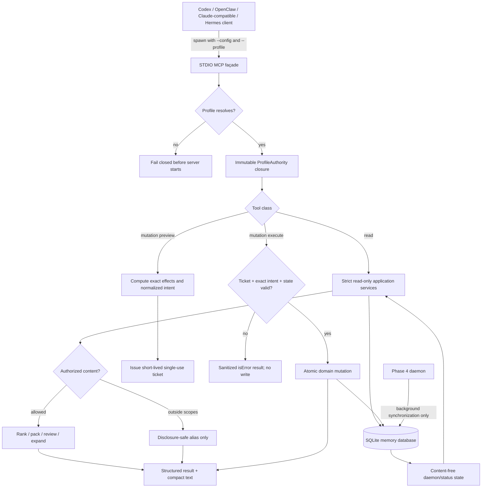

# Phase 5: Generic MCP Interface - Research

**Researched:** 2026-07-18
**Domain:** Local MCP STDIO façade over a person-and-scope-isolated SQLite memory service
**Confidence:** HIGH for repository architecture; MEDIUM for the fast-moving MCP SDK boundary

<user_constraints>
## User Constraints (from CONTEXT.md)

### Locked Decisions

### Connection model
- **D-01:** Ship local STDIO as the initial MCP transport. Localhost Streamable HTTP is not required in Phase 5.
- **D-02:** Each MCP client launches a separate interactive facade that opens the configured SQLite memory database and calls the existing host-neutral services. The Phase 4 daemon remains a separate process and the only background synchronizer.
- **D-03:** MCP remains usable for interactive search, recall, review, and explicitly approved mutations while the daemon is stopped. Status must clearly report synchronization as offline.
- **D-04:** A product configuration file contains named connection profiles and resolves each profile to a memory database. Do not discover or select a database automatically.

### Identity and retrieval scope
- **D-05:** Each named profile fixes exactly one `personId` and its complete allowed-scope list. Individual tool calls do not widen or narrow that list.
- **D-06:** A profile represents a workspace or sensitivity context, not an agent application. Codex, OpenClaw, Claude-compatible clients, and Hermes may share a profile only when they should have identical memory access.
- **D-07:** MCP registrations select a profile explicitly. A missing or unknown profile fails closed; there is no implicit default profile.
- **D-08:** When relevant matches exist outside the profile's scopes, read tools may return redacted match labels without memory content. Labels must come from a disclosure-safe alias vocabulary rather than raw case, client, source, thread, title, or content values.

### Tool and response design
- **D-09:** Use explicit task-specific tools rather than umbrella action parameters or generic CRUD. The initial surface must cover memory search, contextual recall, memory review, subject expansion, source status, history ingestion, proposal listing, proposal approval/rejection, source revocation, and source deletion requests.
- **D-10:** `memory_search` returns ranked, inspectable candidates with identifiers and provenance. `memory_recall` accepts the current task and an explicit token budget and returns a compact disclosure-labeled context packet.
- **D-11:** Read tools return both stable structured data and compact rendered text. Structured results include applicable identifiers, timestamps, confidence, provenance, scopes, budget use, continuation state, and assistive-memory disclosure.
- **D-12:** Verbatim expansion operates on an entire remembered subject rather than requiring callers to select individual result IDs. Expansion still enforces the explicit token budget and uses bounded continuation when the subject is larger than one response.

### Mutation approvals
- **D-13:** Every import, durable memory write, proposal decision, revocation, and deletion operation uses a two-step preview and confirmation flow. Preview returns exact effects plus a short-lived, single-use confirmation token; execution requires the exact target and token.
- **D-14:** Confirmation tokens bind the selected profile, tool, exact target IDs, normalized parameters, expiry, and one-time use. Any changed input requires a new preview.
- **D-15:** Search, recall, expansion, review, and status are semantically read-only and must not strengthen, revive, supersede, or otherwise modify durable memory objects. Content-free operational telemetry may be recorded separately from memory state.
- **D-16:** Source revocation and deletion are separate confirmed operations. Deletion remains unavailable until the exact source has already been revoked, and both transitions retain their existing audit behavior.
- **D-17:** Tool annotations must accurately distinguish read-only and mutating behavior. Host approval prompts supplement the server-enforced confirmation protocol; they are not the sole authorization control.

### the agent's Discretion
- Exact package and module names, MCP SDK wiring, Zod schema decomposition, configuration file location and syntax, confirmation-token cryptographic representation, expiry duration, telemetry representation, pagination cursor encoding, and exact disclosure-safe label vocabulary.
- Exact task-tool names may vary from the examples in D-09 if schemas and safety boundaries stay explicit and one operation cannot smuggle a materially different mutation through an action parameter.
- Exact structured-response field names and rendered-text formatting, provided both representations carry the same authorization boundary, provenance, disclosure, and budget facts.

### Deferred Ideas (OUT OF SCOPE)
- Localhost Streamable HTTP transport is deferred beyond the initial STDIO interface.
- Remote access, cross-device authentication, and zero-knowledge synchronization remain Phase 6.
- First-run profile creation UI, broad packaging, and onboarding remain Phase 7.
</user_constraints>

Source: [VERIFIED: `.planning/phases/05-generic-mcp-interface/05-CONTEXT.md`]

<phase_requirements>
## Phase Requirements

| ID | Description | Research Support |
|----|-------------|------------------|
| REQ-023 | Layered expansion from compact subjects to source-linked verbatim events under an explicit token budget. | Add a strict, subject-oriented expansion service with deterministic event ordering, a shared token estimator, and authenticated continuation cursors. [VERIFIED: `.planning/REQUIREMENTS.md`; `src/resume/conversation-resumer.ts` inspection] |
| REQ-025 | Recalled memory is assistive and includes confidence, timestamps, sources, and disclosure. | Standardize one MCP response envelope whose structured and rendered forms carry identical disclosure, provenance, authorization, and budget facts. [VERIFIED: `.planning/REQUIREMENTS.md`; `src/retrieval/memory-retriever.ts` inspection] |
| REQ-027 | Expose a host-neutral local MCP server. | Use one SDK-managed STDIO child process per client registration, bound at startup to one explicit profile. [VERIFIED: `.planning/REQUIREMENTS.md`; CITED: https://modelcontextprotocol.io/specification/2025-06-18/basic/transports] |
| REQ-028 | Support ingest, search, recall, expansion, review, proposal decisions, source status, and deletion requests. | Register task-specific read, preview, and execute tools over scoped application services; do not expose raw store CRUD. [VERIFIED: `.planning/REQUIREMENTS.md`; `.planning/phases/05-generic-mcp-interface/05-CONTEXT.md`] |
| REQ-029 | Accurately declare read-only/mutating behavior and require approvals for mutations. | Use explicit MCP annotations plus server-enforced preview/confirmation tickets; verify annotations over a real STDIO `tools/list`. [VERIFIED: `.planning/REQUIREMENTS.md`; CITED: https://modelcontextprotocol.io/specification/2025-06-18/server/tools] |
</phase_requirements>

## Summary

Phase 5 is primarily an authorization and service-seam phase, not a JSON-RPC plumbing phase. The repository already has deterministic ranking and packing, source lifecycle operations, importers, proposal review, daemon status, and SQLite storage. However, the current recall path writes injection packets and strengthens/revives summaries; the current resumer expands globally addressable summary/trace/box IDs without a person/scope boundary or token continuation; proposal listing and decisions are globally addressable; and source deletion/proposal approval span multiple writes without a single transaction. These paths cannot be wrapped directly and still satisfy D-05, D-12, D-15, and D-16. [VERIFIED: `src/retrieval/memory-retriever.ts`, `src/resume/conversation-resumer.ts`, `src/proposals/proposal-reviewer.ts`, `src/service/source-lifecycle-service.ts` inspection]

Build a transport-neutral `src/mcp/` application layer whose constructor receives a fully resolved, immutable profile. Read handlers must use new strict read-only query/review/expansion services and never call `MemoryRetriever.prepareInjection()`. Mutation handlers must be split into explicit preview and execute tools, with a process-local cryptographically random, short-lived, single-use ticket bound to the profile and normalized exact intent. Execution must revalidate state and effects inside one SQLite transaction before consuming the mutation. [RECOMMENDATION]

Use the supported production v1 TypeScript SDK, `@modelcontextprotocol/sdk` 1.29.0, not the v2 beta split packages. SDK v1.29.0 requires Zod `^3.25 || ^4.0`, while the project declares Zod `^3.23.8`; upgrade to Zod 3.25.76 to remain on the existing v3 API and avoid an unrelated v4 migration. The official repository currently says v1.x remains the production-supported release while v2 is beta. [VERIFIED: npm registry and package-legitimacy seam; CITED: https://github.com/modelcontextprotocol/typescript-sdk]

**Primary recommendation:** Plan storage/concurrency and strict application-service foundations first, then MCP schemas/handlers, then real synthetic STDIO protocol and host-registration UAT. [RECOMMENDATION]

## Architectural Responsibility Map

| Capability | Primary Tier | Secondary Tier | Rationale |
|------------|-------------|----------------|-----------|
| STDIO lifecycle and MCP schema exposure | Local client façade | Host MCP client | The child process owns JSON-RPC framing and tool registration; the host owns spawn/shutdown and optional prompts. [CITED: https://modelcontextprotocol.io/specification/2025-06-18/basic/transports] |
| Profile selection and authorization context | Local client façade | Configuration | Startup resolves exactly one profile; handlers receive authority by closure, never from tool arguments. [VERIFIED: Phase 5 D-04 through D-07] |
| Ranking, recall packing, and review | Service layer | Storage | Host-neutral services own behavior; MCP only validates and maps envelopes. [VERIFIED: `src/retrieval/`, `src/service/`, `src/proposals/` inspection] |
| Person/scope filtering | Service and storage query boundary | MCP disclosure mapper | Every object and dependency is checked before content is shaped for transport. [VERIFIED: ADR 0046 and current `applyRetrievalBoundary()`] |
| Subject-level verbatim expansion | New strict expansion service | Canonical event storage | The service resolves a subject to authorized canonical ranges and applies budget/cursor policy. [VERIFIED: REQ-023 and current resumer gap] |
| Confirmation tickets | MCP application service | Atomic domain mutation service | Tickets bind protocol intent; domain/storage transactions recheck and commit effects. [VERIFIED: Phase 5 D-13 through D-16] |
| Daemon synchronization | Phase 4 daemon | SQLite | MCP reads daemon state but never becomes a synchronizer. [VERIFIED: Phase 5 D-02 and `src/daemon/`] |
| Persistence and concurrency | SQLite store | Service transaction boundary | Multiple client facades and the daemon open the same local database; SQLite remains the authority. [VERIFIED: Phase 5 D-02 and `src/storage/sqlite-store.ts`] |

## Project Constraints (from AGENTS.md)

- Preserve strict workspace/thread/person/client/case isolation and treat persisted memory as assistive rather than authoritative. [VERIFIED: `AGENTS.md`]
- Preserve source IDs, trace IDs, timestamps, confidence, and provenance already tracked by the system. [VERIFIED: `AGENTS.md`]
- Never auto-approve proposals, box changes, sleep conclusions, or review-gated injected memory. [VERIFIED: `AGENTS.md`]
- Never persist raw secrets or client documents; redact secrets as `[REDACTED]`. [VERIFIED: `AGENTS.md`]
- External LLMs must remain optional and mockable; deterministic/local MCP tests must not require OpenRouter. [VERIFIED: `AGENTS.md`]
- Budget packing changes require deterministic tests for limits, ordering, and fallback behavior. [VERIFIED: `AGENTS.md`]
- Preserve unrelated dirty work, keep diffs scoped, and treat `example/` as reference material unless explicitly targeted. [VERIFIED: `AGENTS.md`]
- Read relevant ADRs, add tests beside changed behavior, and finish with `git diff --check`, relevant Vitest, and TypeScript checks. [VERIFIED: `AGENTS.md`]
- This research used only code inspection and synthetic test fixtures; no live personal history was opened. [VERIFIED: research execution]

## Standard Stack

### Core

| Library | Version | Purpose | Why Standard |
|---------|---------|---------|--------------|
| `@modelcontextprotocol/sdk` | 1.29.0, published 2026-03-30 | MCP server/client types, `McpServer`, `StdioServerTransport`, tool schemas, annotations, and integration-test client. | It is the official production-supported TypeScript SDK generation on the research date; registry legitimacy verdict is `OK` and no postinstall script is present. [VERIFIED: npm registry; CITED: https://ts.sdk.modelcontextprotocol.io/server] |
| `zod` | 3.25.76, published 2025-07-08 | Input, output, profile, ticket-intent, cursor, and response validation. | It is the smallest compatible upgrade from current 3.23.8 and satisfies SDK 1.29.0's `^3.25 || ^4.0` peer range without a v4 migration. [VERIFIED: npm registry; `package.json`] |
| `node:sqlite` | bundled with Node 24.7.0; SQLite 3.53.1 in this environment | Local authority, read-only connections, transactions, and concurrent daemon/facade access. | Already used by `SqliteStore`; no new database package is needed. [VERIFIED: environment probe; `src/storage/sqlite-store.ts`] |
| `node:crypto` | bundled with Node | Random confirmation tokens, intent hashes, HMAC cursor authentication, and timing-safe comparison. | Use platform cryptographic primitives instead of custom crypto or another dependency. [VERIFIED: Node standard library availability] |

### Supporting

| Library | Version | Purpose | When to Use |
|---------|---------|---------|-------------|
| Vitest | declared `^2.0.5`, installed 2.1.9 | Unit, SQLite integration, STDIO protocol, and adversarial isolation tests. | All new MCP behavior and synthetic client/server transcripts. [VERIFIED: `package.json`, local executable] |
| TypeScript | declared `^5.5.3`, installed 5.9.3 | Strict request/response and authority-context typing. | All production and test code. [VERIFIED: `package.json`, local executable] |
| `tsx` | declared `^4.16.2`, installed 4.21.0 | Local executable entry point and spawned test server. | `memory:mcp` script and synthetic STDIO child process. [VERIFIED: `package.json`, local executable] |

### Alternatives Considered

| Instead of | Could Use | Tradeoff |
|------------|-----------|----------|
| SDK v1.29.0 | v2 beta split packages | Do not use in this phase: official repository says v2 is beta and v1.x is the supported production release as of 2026-07-18. Recheck only if implementation starts after the announced 2026-07-28 release boundary. [CITED: https://github.com/modelcontextprotocol/typescript-sdk] |
| Official SDK transport | Hand-written JSON-RPC framing | Reject: newline framing, lifecycle negotiation, error mapping, schema advertisement, and compatibility are protocol responsibilities already implemented by the SDK. [CITED: https://modelcontextprotocol.io/specification/2025-06-18/basic/transports] |
| Zod 3.25.76 | Zod 4.4.3 | Zod 4 is supported by the SDK, but adopting it would widen Phase 5 into an unrelated repository-wide schema migration. [VERIFIED: npm registry and SDK peer dependencies] |
| Process-local confirmation tickets | Durable ticket table | Process-local tickets naturally expire on client disconnect and avoid durable sensitive intent; durable tickets are only justified if confirmation must survive process restart, which D-13 does not require. [RECOMMENDATION] |

**Installation:**

```bash
npm install @modelcontextprotocol/sdk@1.29.0 zod@3.25.76
```

[VERIFIED: npm registry and package-legitimacy seam]

## Package Legitimacy Audit

| Package | Registry | Age | Downloads | Source Repo | Verdict | Disposition |
|---------|----------|-----|-----------|-------------|---------|-------------|
| `@modelcontextprotocol/sdk` | npm | Version 1.29.0 published 2026-03-30 | 39,447,972/week at audit | `github.com/modelcontextprotocol/typescript-sdk` | OK | Approved; officially documented. [VERIFIED: npm registry; package-legitimacy seam; official SDK docs] |
| `zod` | npm | Package created 2020-03-07; selected 3.25.76 published 2025-07-08 | 212,737,786/week at audit | `github.com/colinhacks/zod` | OK | Approved; upgrade existing dependency. [VERIFIED: npm registry; package-legitimacy seam] |

**Packages removed due to [SLOP] verdict:** none. [VERIFIED: package-legitimacy seam]

**Packages flagged as suspicious [SUS]:** none. [VERIFIED: package-legitimacy seam]

## Architecture Patterns

### System Architecture Diagram



[VERIFIED: Phase 5 decisions; repository service and storage inspection]

### Recommended Project Structure

```text
src/mcp/
├── server-command.ts          # parse startup args; stderr-only diagnostics
├── server.ts                  # McpServer construction and STDIO connection
├── profile-loader.ts          # validate config and resolve one explicit profile
├── authority.ts               # immutable person/scope/profile/database context
├── response-envelope.ts       # structuredContent + compact text parity
├── tool-catalog.ts            # explicit registrations and annotations
├── confirmation-service.ts    # short-lived single-use bound tickets
├── continuation-cursor.ts     # authenticated stateless read cursor
├── disclosure-labels.ts       # safe aliases; never raw restricted metadata
└── tools/                     # one handler module per task-specific tool
src/retrieval/
├── memory-query-service.ts    # pure search/recall; no strength/access writes
└── subject-expansion-service.ts # strict budgeted canonical expansion
src/proposals/
└── scoped-proposal-reviewer.ts # person + dependency scope filtering
tests/mcp/
├── profile-loader.test.ts
├── read-tools.test.ts
├── confirmation-service.test.ts
├── mutation-tools.test.ts
├── subject-expansion.test.ts
└── stdio-server.test.ts
```

[RECOMMENDATION grounded in existing adapter-boundary pattern: `src/integrations/hermes/`, ADR 0039, REQ-030]

### Component Responsibilities

| Component | Responsibility | Must Not Do |
|-----------|----------------|-------------|
| `profile-loader` | Validate versioned config; resolve an explicit name to canonical database path, one person, normalized complete scopes, safe aliases, and a fixed ingest scope/root policy. | Discover databases, infer a profile from host/cwd, or accept person/scope tool arguments. [RECOMMENDATION] |
| `memory-query-service` | Reuse pure ranking/packing logic and return inspectable candidates/packets. | Save injection packets, change access timestamps/counts/strength, or revive stale summaries. [VERIFIED: current mutation exists in `MemoryRetriever.prepareInjection()`] |
| `subject-expansion-service` | Resolve a subject, prove every dependency and event is authorized, order canonical events deterministically, pack to budget, and issue continuation. | Expand caller-selected global IDs through current `ConversationResumer`. [VERIFIED: current resumer lacks authorization and token budget] |
| `scoped-proposal-reviewer` | Filter proposal person and every referenced summary scope before listing/previewing/deciding. | Call current global `listProposals()` or `getProposal(id)` without dependency checks. [VERIFIED: `ProposalReviewer` current behavior] |
| `confirmation-service` | Bind profile fingerprint, tool, exact IDs, canonical parameters, effects fingerprint, expiry, and one-time state. | Treat a host approval prompt, a matching candidate ID alone, or a bearer token without parameter binding as authorization. [VERIFIED: Phase 5 D-13, D-14, D-17] |
| mutation services | Revalidate ticket intent and current state, then atomically import/decide/revoke/delete and audit. | Partially commit multi-object effects. [VERIFIED: current source deletion and proposal approval are multi-write sequences] |
| MCP handlers | Validate, call one application operation, sanitize failures, render the envelope. | Contain storage queries, business branching, host-specific parsing, or secret-bearing logs. [VERIFIED: REQ-030 and `AGENTS.md`] |

### Pattern 1: Startup-Bound Authority

Resolve `--config <absolute-path> --profile <name>` before connecting STDIO. The returned `ProfileAuthority` is immutable and captured by every handler. Tool schemas contain neither database path, profile name, person ID, nor allowed scopes. [RECOMMENDATION]

Recommended versioned profile shape:

```json
{
  "version": 1,
  "profiles": {
    "personal": {
      "databasePath": "/absolute/path/memory.sqlite",
      "personId": "person_1",
      "allowedScopeIds": ["personal"],
      "ingestScopeId": "personal",
      "scopeAliases": {
        "personal": "personal context",
        "restricted": "restricted context"
      },
      "sourceRoots": {
        "codex": "/configured/codex/root"
      }
    }
  }
}
```

`ingestScopeId` must be one member of `allowedScopeIds`; configured root aliases prevent a model from turning a metadata-preview tool into arbitrary filesystem probing. [RECOMMENDATION]

### Pattern 2: Pure Reads With a Storage-Enforced Backstop

Create a `SqliteStore` read-only mode that does not run migrations, and use that connection for read handlers. Open a write-capable connection lazily only inside confirmed execute handlers. This makes D-15 testable below the MCP annotation layer. [RECOMMENDATION]

Extract ranking and budget packing from `MemoryRetriever` into pure functions/services. Keep the legacy Hermes compatibility path intact, but do not call `prepareInjection()` from MCP because it writes an injection packet and strengthens/revives summaries. [VERIFIED: `src/retrieval/memory-retriever.ts`]

### Pattern 3: Subject Expansion With Stateless Continuation

`memory_expand_subject` should accept a subject query/reference, explicit positive token budget, and optional cursor—not a list of result IDs. Resolve the subject under the immutable profile, collect all related summary/trace/box dependencies, reject mixed or unknown ownership, then expand authorized canonical events in `(occurredAt, nativeSequence, id)` order. [RECOMMENDATION; VERIFIED ordering source: `SqliteStore.listCanonicalEvents()`]

Use one shared deterministic estimator and report `budgetRequested`, `budgetUsed`, `budgetUnit`, and `estimatorVersion`. A stateless HMAC-authenticated cursor should bind the profile fingerprint, normalized subject hash, next canonical order key, estimator version, and expiry; changed subject/profile/budget policy invalidates it. The cursor contains no memory text and requires no durable read-side write. [RECOMMENDATION]

### Pattern 4: Preview → Confirm → Atomic Execute

Use separate task-specific preview and execute tools. Preview performs only the minimum read needed to compute exact effects, normalizes all strings/arrays/IDs, hashes the intent/effects, and stores only a hash-keyed process-local ticket. Execute compares the exact normalized intent, consumes the ticket before attempting the write, revalidates state/effects in an immediate transaction, and requires a new preview after any failure or drift. [RECOMMENDATION]

The current `SourceLifecycleService.deleteRevokedSource()` and proposal approval paths make several writes without one surrounding transaction; add atomic store/service operations before exposing them through MCP. [VERIFIED: `src/service/source-lifecycle-service.ts`, `src/proposals/proposal-reviewer.ts`, `src/storage/sqlite-store.ts`]

### Pattern 5: Stable Dual Representation

Every successful tool returns a small human-readable TextContent block and the same facts in `structuredContent`; declare an `outputSchema` for each result. The MCP specification says structured results should also be serialized as text for backward compatibility and must match a declared output schema. [CITED: https://modelcontextprotocol.io/specification/2025-06-18/server/tools]

Use stable error codes such as `PROFILE_NOT_FOUND`, `UNAUTHORIZED_SCOPE`, `CONFIRMATION_EXPIRED`, `CONFIRMATION_MISMATCH`, `STATE_CHANGED`, and `SOURCE_NOT_REVOKED`. Return business/state failures as sanitized `isError: true` tool results; leave malformed arguments/unknown tools to protocol errors. [RECOMMENDATION; error distinction CITED: https://modelcontextprotocol.io/specification/2025-06-18/server/tools]

### Pattern 6: SQLite Multi-Process Discipline

The daemon and separate MCP child processes create concurrent same-host connections. The current store opens with Node's default zero lock timeout and does not configure WAL. Node documents `DatabaseSync`'s default busy timeout as zero; SQLite documents that WAL permits concurrent readers and a writer but still has only one writer. [VERIFIED: `src/storage/sqlite-store.ts`; CITED: https://nodejs.org/api/sqlite.html; CITED: https://sqlite.org/wal.html]

Configure a bounded busy timeout on every connection, use WAL only after verifying the embedded SQLite fix level, keep read transactions short, and wrap each confirmed mutation in `BEGIN IMMEDIATE`/commit/rollback. The local environment embeds SQLite 3.53.1, newer than SQLite's published WAL-reset fix boundary. [RECOMMENDATION; VERIFIED: environment probe; CITED: https://sqlite.org/wal.html]

### Tool Catalog and Annotations

| Tool class | Suggested tools | `readOnlyHint` | `destructiveHint` | `idempotentHint` | `openWorldHint` |
|------------|-----------------|----------------|-------------------|------------------|-----------------|
| Pure reads | `memory_search`, `memory_recall`, `memory_review`, `memory_expand_subject`, `source_status`, `proposal_list` | true | false | true | false |
| Preview/ticket issuance | `history_ingest_preview`, `proposal_approve_preview`, `proposal_reject_preview`, `source_revoke_preview`, `source_delete_preview` | false | false | false | false |
| Additive execute | `history_ingest_execute` | false | false | false | false |
| Durable decision execute | `proposal_approve_execute`, `proposal_reject_execute`, `source_revoke_execute` | false | true | false | false |
| Destructive execute | `source_delete_execute` | false | true | false | false |

Preview tools are not read-only because issuing a single-use ticket changes server state. Execute tools are conservatively non-idempotent because the exact token is one-use and a lost response cannot be safely retried as the same call unless a replay-receipt design is added. Tool annotations are hints rather than enforcement and default conservatively when omitted. [RECOMMENDATION; CITED: https://modelcontextprotocol.io/specification/2025-06-18/server/tools; CITED: https://blog.modelcontextprotocol.io/posts/2026-03-16-tool-annotations/]

### Anti-Patterns to Avoid

- **Passing profile/person/scopes/database in tool arguments:** lets a caller attempt authority changes; bind them at startup instead. [VERIFIED: Phase 5 D-04 through D-07]
- **Wrapping existing recall directly:** it silently writes and revives memory, invalidating `readOnlyHint: true`. [VERIFIED: `MemoryRetriever.prepareInjection()`]
- **Expanding a caller-supplied summary/box/trace ID:** current getters are global and can bypass profile scope. [VERIFIED: `ConversationResumer`, `ProposalReviewer`]
- **Using raw scope IDs or titles as blocked-match labels:** this leaks the sensitive namespace even when snippets are redacted. [VERIFIED: Phase 5 D-08]
- **Relying on host prompts:** clients differ and annotations are untrusted hints; the ticket protocol is the authorization control. [CITED: official MCP tools specification; VERIFIED: Phase 5 D-17]
- **Logging to stdout:** any non-MCP stdout breaks STDIO framing; logs belong on stderr and must be content-free. [CITED: https://modelcontextprotocol.io/specification/2025-06-18/basic/transports]
- **Keeping current zero-timeout SQLite connections:** concurrent facade/daemon writes will surface immediate lock failures. [VERIFIED: current constructor; CITED: https://nodejs.org/api/sqlite.html]
- **Returning raw exception messages:** paths, IDs, or memory text may escape through model-visible errors. [VERIFIED: `AGENTS.md` privacy constraints]

## Don't Hand-Roll

| Problem | Don't Build | Use Instead | Why |
|---------|-------------|-------------|-----|
| MCP framing/lifecycle | Custom line reader and JSON-RPC dispatcher | Official `McpServer` + `StdioServerTransport` | Handles initialization, capabilities, framing, disconnects, and protocol errors. [CITED: official SDK server guide and MCP lifecycle spec] |
| Request/response JSON Schema | Ad hoc validators | Zod schemas passed to SDK `inputSchema`/`outputSchema` | The SDK advertises and validates schemas; output conformance is a protocol requirement when declared. [CITED: https://ts.sdk.modelcontextprotocol.io/server] |
| Cryptographic randomness/MAC | Timestamp tokens, UUID concatenation, custom signatures | `node:crypto.randomBytes`, HMAC, timing-safe compare | Confirmation and cursor integrity require established primitives. [RECOMMENDATION] |
| Memory ranking | A second MCP-specific ranker | Extract current deterministic ranking/packing into a pure service | Prevents behavior drift while removing semantic writes. [VERIFIED: `src/retrieval/memory-retriever.ts`] |
| Source import/parsing | MCP-specific parsers | Existing Codex/Claude/OpenClaw/Hermes discovery and import services | Existing paths already preserve approval, checkpoints, source read-only behavior, and deterministic identities. [VERIFIED: `src/imports/`] |
| Revocation/deletion semantics | Direct table deletes | `SourceLifecycleService` behind a new atomic transaction boundary | Existing behavior preserves revocation prerequisite, audit, attributable deletion, and derived invalidation. [VERIFIED: ADR 0044 and service code] |
| Client approval | An annotation-only safety policy | Server ticket protocol plus accurate annotations | MCP annotations are untrusted hints, not enforcement. [CITED: official MCP tools specification] |

**Key insight:** MCP should expose already-proven domain operations through a stricter authority boundary; it should not become a parallel memory implementation. [RECOMMENDATION]

## Common Pitfalls

### Pitfall 1: “Read” Tools That Mutate Memory

**What goes wrong:** search/recall changes strength, state, counts, timestamps, or injections while advertised read-only. [VERIFIED: current `MemoryRetriever.prepareInjection()` behavior]

**How to avoid:** use a read-only SQLite connection and a pure query service; test before/after snapshots of every durable table. [RECOMMENDATION]

**Warning signs:** `save*` calls reachable from read handlers, changed database hash/counts, or stale summaries becoming revived. [RECOMMENDATION]

### Pitfall 2: Authorization After Lookup

**What goes wrong:** a globally loaded proposal/box/trace or exception text leaks existence/content before scope validation. [VERIFIED: current global getter/list patterns]

**How to avoid:** require person and all dependency scopes in the query/service boundary; return one generic not-found/unauthorized error externally. [RECOMMENDATION]

**Warning signs:** handler accepts raw IDs; filtering occurs after rendering; errors include raw titles, paths, or IDs from another scope. [RECOMMENDATION]

### Pitfall 3: Confirmation Token Not Bound to Effects

**What goes wrong:** a token previewed for one target is replayed with changed note, source root, proposal, or deletion target. [VERIFIED: Phase 5 D-14 threat]

**How to avoid:** canonicalize and hash profile/tool/targets/parameters/effects; compare exact intent; expire and consume once; re-preview on drift. [RECOMMENDATION]

**Warning signs:** token lookup alone authorizes, arrays are compared without normalization, or execute recomputes a different target set silently. [RECOMMENDATION]

### Pitfall 4: Non-Atomic Multi-Object Mutation

**What goes wrong:** crash/lock failure leaves proposal/source state partly updated and audit inconsistent. [VERIFIED: current multi-write service paths]

**How to avoid:** add task-specific transaction methods and fault-injection tests at every write boundary. [RECOMMENDATION based on existing daemon fault-injection pattern]

**Warning signs:** several awaited `save*`/`delete*` calls without one transaction; audit written before a later failure with no rollback. [VERIFIED: code inspection]

### Pitfall 5: STDIO Contamination and Lifecycle Leaks

**What goes wrong:** startup logs corrupt JSON-RPC, SQLite remains open after EOF, or abrupt host disconnect raises EPIPE noise. [CITED: MCP transport and lifecycle specs]

**How to avoid:** reserve stdout for transport, log sanitized operational codes to stderr, close transport/store on EOF/signals, and let the SDK own framing. [RECOMMENDATION]

**Warning signs:** `console.log` in server path, process remains after client closes stdin, or non-JSON stdout in transcript. [RECOMMENDATION]

### Pitfall 6: Restricted Match Labels Become a Side Channel

**What goes wrong:** label counts, ordering, raw scope IDs, titles, paths, or session IDs reveal a case/client context. [VERIFIED: Phase 5 D-08]

**How to avoid:** map immediately to a small configured alias vocabulary; coarsen counts; use generic fallback; adversarially snapshot all blocked outputs/errors/logs. [RECOMMENDATION]

### Pitfall 7: SDK Generation Drift

**What goes wrong:** a plan written against v2 beta imports or Zod 4 patterns conflicts with the supported v1 package and current repository. [CITED: official TypeScript SDK repository status]

**How to avoid:** pin v1.29.0/Zod 3.25.76 for this phase; if implementation starts on/after 2026-07-28, perform a short package/docs recheck before installing but do not mix generations mid-phase. [RECOMMENDATION]

## Code Examples

### SDK-Managed STDIO Entry Point

```typescript
// Source: https://ts.sdk.modelcontextprotocol.io/server (v1)
import { McpServer } from "@modelcontextprotocol/sdk/server/mcp.js";
import { StdioServerTransport } from "@modelcontextprotocol/sdk/server/stdio.js";

const authority = await loadExplicitProfile(process.argv.slice(2));
const app = await createMemoryMcpApplication(authority);
const server = new McpServer(
  { name: "conversational-memory", version: "0.1.0" },
  { instructions: "Memory is assistive, scoped context. Preview then confirm every mutation." }
);

registerMemoryTools(server, app);
await server.connect(new StdioServerTransport());
```

Codex officially supports STDIO command/args registrations and reads server instructions; instructions are guidance only, not authorization. [CITED: https://developers.openai.com/codex/mcp]

### Read Tool With Dual Output and Accurate Annotations

```typescript
// Source pattern: https://ts.sdk.modelcontextprotocol.io/server
server.registerTool(
  "memory_recall",
  {
    description: "Return profile-scoped assistive context for the current task.",
    inputSchema: {
      task: z.string().min(1).max(8_000),
      tokenBudget: z.number().int().positive().max(8_000)
    },
    outputSchema: RecallResultShape,
    annotations: {
      title: "Recall scoped memory",
      readOnlyHint: true,
      destructiveHint: false,
      idempotentHint: true,
      openWorldHint: false
    }
  },
  async (input) => {
    const result = await app.recall(input); // authority is captured, not passed
    return {
      content: [{ type: "text", text: renderRecall(result) }],
      structuredContent: result
    };
  }
);
```

The structured result must conform to its output schema, and a text representation should accompany it for compatibility. [CITED: https://modelcontextprotocol.io/specification/2025-06-18/server/tools]

### Confirmation Intent Binding

```typescript
// Source: Phase 5 D-13/D-14; cryptographic primitives from node:crypto
const normalized = normalizeIntent({
  profileFingerprint: authority.fingerprint,
  tool: "source_delete_execute",
  targetIds: [input.candidateId].sort(),
  parameters: { candidateId: input.candidateId },
  effectsFingerprint: preview.effectsFingerprint
});

const ticket = confirmations.issue(normalized, { ttlMs: 5 * 60_000 });
// execute: confirmations.consumeExact(ticket, normalized), then transactionally
// revalidate revoked state and effects before deletion.
```

The five-minute TTL is a recommended default, not a locked requirement. [RECOMMENDATION]

## State of the Art

| Old/Current Approach | Phase 5 Approach | Impact |
|----------------------|------------------|--------|
| Legacy Hermes may opt into unscoped retrieval. | MCP always supplies profile-bound person and full allowed scopes. | No legacy-unscoped MCP path. [VERIFIED: ADR 0046] |
| Recall persists injection/access/revival state. | MCP query/recall is a pure read with optional separate content-free telemetry. | Makes `readOnlyHint: true` truthful. [VERIFIED: current retriever gap and D-15] |
| Resume expands individual global IDs and uses a range cap. | Expand a subject under an explicit token budget with authenticated continuation. | Meets REQ-023 and closes ID-based scope bypass. [VERIFIED: current resumer gap] |
| CLI import/delete confirms only by candidate ID. | Every mutation uses exact-effects preview and a bound single-use token. | Host prompts become defense in depth, not the enforcement point. [VERIFIED: current commands and D-13/D-14] |
| SDK v2 split packages are beta on 2026-07-18. | Pin supported v1.29.0 for Phase 5. | Avoids beta API and Zod 4 migration risk. [CITED: official SDK repository] |

**Deprecated/outdated:**

- The older SDK `.tool()` registration style is deprecated; use `registerTool()`. [CITED: official TypeScript SDK server guide]
- HTTP+SSE is legacy and Streamable HTTP is the current HTTP transport, but all HTTP transports are out of Phase 5. [CITED: official TypeScript SDK v1 server guide; VERIFIED: Phase 5 D-01]
- Generic or umbrella CRUD/action tools conflict with the locked task-specific surface. [VERIFIED: Phase 5 D-09]

## Assumptions Log

| # | Claim | Section | Risk if Wrong |
|---|-------|---------|---------------|
| — | None. Recommendations within the agent's discretion are labeled `[RECOMMENDATION]`; current technical facts are verified or cited. | — | — |

## Resolved Questions

1. **SDK generation at execution time — RESOLVED**
   - What we know: v1.29.0 is the supported production release and v2 is beta on 2026-07-18. [CITED: official SDK repository]
   - Decision: Phase 5 uses `@modelcontextprotocol/sdk@1.29.0` with `zod@3.25.76` for the entire phase. If installation starts on or after 2026-07-28, execution records a brief official-package/API status recheck but does not change SDK generation without a separate approved replan. This keeps one tested API generation across all Phase 5 plans. [RESOLVED; RECOMMENDATION]

2. **Host-level live UAT availability — RESOLVED**
   - What we know: Codex, Claude Code, and OpenClaw official docs support locally spawned STDIO MCP servers. [CITED: https://developers.openai.com/codex/mcp; CITED: https://docs.anthropic.com/en/docs/claude-code/mcp; CITED: https://docs.openclaw.ai/cli/mcp]
   - Decision: the SDK-driven synthetic STDIO lifecycle is the blocking automated acceptance gate. Plan 08 additionally attempts synthetic-data registration smoke checks only for locally installed hosts, records each unavailable or unauthenticated host as unavailable rather than failed, and uses the SDK smoke adapter for Hermes unless a direct MCP consumer is already present. No live personal history or real host configuration is required. [RESOLVED; RECOMMENDATION]

## Environment Availability

| Dependency | Required By | Available | Version | Fallback |
|------------|-------------|-----------|---------|----------|
| Node.js | runtime and `node:sqlite` | ✓ | 24.7.0 | none; project already depends on `node:sqlite`. [VERIFIED: environment] |
| Embedded SQLite | shared memory database | ✓ | 3.53.1 | none. [VERIFIED: `select sqlite_version()` synthetic probe] |
| npm | dependency install | ✓ | 11.5.1 | package-lock install. [VERIFIED: environment] |
| Vitest | tests | ✓ | 2.1.9 installed | `npm test`. [VERIFIED: environment] |
| TypeScript | typecheck | ✓ | 5.9.3 installed | `npm run typecheck`. [VERIFIED: environment] |
| `tsx` | STDIO entry point | ✓ | 4.21.0 installed | compile then run Node. [VERIFIED: environment] |
| MCP SDK | production code/test client | ✗ | not installed | install verified 1.29.0 in Wave 0. [VERIFIED: `package.json`, npm registry] |

**Missing dependencies with no fallback:** `@modelcontextprotocol/sdk` must be installed for implementation. [VERIFIED: current `package.json`]

**Missing dependencies with fallback:** none. [VERIFIED: environment audit]

## Validation Architecture

### Test Framework

| Property | Value |
|----------|-------|
| Framework | Vitest, installed 2.1.9. [VERIFIED: environment] |
| Config file | `vitest.config.ts`. [VERIFIED: codebase] |
| Quick run command | `npx vitest run tests/mcp` |
| Full suite command | `npm test && npm run typecheck` |

### Phase Requirements → Test Map

| Req ID | Behavior | Test Type | Automated Command | File Exists? |
|--------|----------|-----------|-------------------|-------------|
| REQ-023 | Subject expansion returns authorized canonical events in deterministic order, never exceeds declared estimated budget, and resumes without gaps/duplicates. | unit + SQLite integration | `npx vitest run tests/mcp/subject-expansion.test.ts` | ❌ Wave 0 |
| REQ-025 | Search/recall/expand structured and rendered outputs contain disclosure, confidence, timestamps, provenance, scopes, and budget facts without mutation. | unit + snapshot | `npx vitest run tests/mcp/read-tools.test.ts` | ❌ Wave 0 |
| REQ-027 | Real child process completes initialize/list/call/shutdown over clean STDIO; unknown/missing profile fails before serving. | protocol integration | `npx vitest run tests/mcp/stdio-server.test.ts` | ❌ Wave 0 |
| REQ-028 | Every required read/mutation capability is discoverable and routes to one explicit service; daemon-off status remains usable/offline. | integration | `npx vitest run tests/mcp/tool-catalog.test.ts tests/mcp/mutation-tools.test.ts` | ❌ Wave 0 |
| REQ-029 | `tools/list` annotations match semantic behavior; preview/execute rejects missing, expired, replayed, cross-profile, changed-target, changed-parameter, and drifted-state tokens. | protocol + adversarial | `npx vitest run tests/mcp/confirmation-service.test.ts tests/mcp/stdio-server.test.ts` | ❌ Wave 0 |

### Required Adversarial Fixtures

- Two people, at least three scopes, a mixed-scope summary, and proposals/traces/boxes whose dependencies cross scopes. [RECOMMENDATION grounded in ADR 0046]
- Disclosure-safe aliases deliberately different from raw scope/title/path/session/candidate values. [RECOMMENDATION grounded in D-08]
- Read-table snapshots proving zero semantic writes after every read tool, including no injection/access/revival changes. [RECOMMENDATION grounded in D-15]
- Fault injection during proposal approval, revocation, and deletion to prove full rollback and ticket consumption. [RECOMMENDATION grounded in current store fault-injection patterns]
- Concurrent daemon-like writer plus multiple read clients and two confirmed writers to exercise timeout/transaction behavior. [RECOMMENDATION grounded in D-02]
- Raw stdout capture proving every line is valid MCP JSON-RPC and diagnostics appear only on stderr. [RECOMMENDATION grounded in MCP STDIO specification]

### Sampling Rate

- **Per task commit:** `npx vitest run tests/mcp` plus the nearest changed subsystem test.
- **Per wave merge:** `npm test && npm run typecheck`.
- **Phase gate:** full suite green, synthetic SDK client STDIO smoke green, database unchanged after read suite, and available host registrations proven with synthetic memory only. [RECOMMENDATION]

### Wave 0 Gaps

- [ ] Install `@modelcontextprotocol/sdk@1.29.0` and upgrade `zod` to 3.25.76.
- [ ] Add `tests/mcp/profile-loader.test.ts`.
- [ ] Add `tests/mcp/read-tools.test.ts`.
- [ ] Add `tests/mcp/subject-expansion.test.ts`.
- [ ] Add `tests/mcp/confirmation-service.test.ts`.
- [ ] Add `tests/mcp/mutation-tools.test.ts`.
- [ ] Add `tests/mcp/tool-catalog.test.ts`.
- [ ] Add `tests/mcp/stdio-server.test.ts` and synthetic child config/database fixtures.

## Security Domain

Security enforcement is enabled because `.planning/config.json` does not set `security_enforcement: false`. [VERIFIED: `.planning/config.json`]

### Applicable ASVS Categories

| ASVS Category | Applies | Standard Control |
|---------------|---------|-----------------|
| V2 Authentication | no remote authentication in Phase 5 | Local child-process identity is not user authentication; explicit profile binding is the authorization context. [VERIFIED: D-01, D-07] |
| V3 Session Management | limited | STDIO process lifetime plus short-lived, single-use confirmation state; tokens die with the process. [RECOMMENDATION] |
| V4 Access Control | yes | Immutable profile authority, strict person/scope/dependency filters, fail-closed unknown profile/object behavior. [VERIFIED: ADR 0046] |
| V5 Input Validation | yes | Zod schemas, bounded strings/arrays/budgets, configured source aliases, and normalized exact intent. [RECOMMENDATION; MCP validation requirement CITED: tools spec] |
| V6 Cryptography | yes | Node crypto random tokens and HMAC; never custom cryptographic algorithms. [RECOMMENDATION] |
| V7 Error/Logging | yes | Sanitized stable tool errors; content-free stderr; stdout reserved for MCP. [VERIFIED: AGENTS privacy rules; CITED: STDIO spec] |
| V8 Data Protection | yes | No secrets/raw restricted metadata in results, tickets, cursors, telemetry, or logs; native histories remain read-only. [VERIFIED: AGENTS and ADR 0044] |

### Known Threat Patterns for Local MCP Memory

| Pattern | STRIDE | Standard Mitigation |
|---------|--------|---------------------|
| Tool argument attempts to select another person/scope/database | Elevation of Privilege | Remove authority fields from schemas; bind immutable startup profile. [VERIFIED: D-04 through D-07] |
| Raw-ID expansion/proposal enumeration | Information Disclosure | Query by person plus all dependency scopes before lookup/render; generic external failures. [VERIFIED: ADR 0046] |
| Blocked-match label side channel | Information Disclosure | Fixed safe vocabulary, generic fallback, no raw counts/titles/paths/session IDs. [VERIFIED: D-08] |
| Preview token replay/substitution | Spoofing/Tampering | Random single-use ticket bound to normalized profile/tool/targets/parameters/effects/expiry. [VERIFIED: D-13/D-14] |
| Lost response followed by retry | Repudiation/Tampering | Conservative non-idempotent annotation; consumed ticket; auditable mutation receipt; require re-preview. [RECOMMENDATION] |
| Partial proposal/deletion commit | Tampering | Immediate SQLite transaction, state/effect revalidation, fault-injection rollback tests. [RECOMMENDATION] |
| STDIO stdout injection | Tampering/Denial of Service | Official transport owns stdout; diagnostics only on sanitized stderr. [CITED: MCP transports spec] |
| Concurrent daemon/facade lock failure | Denial of Service | Bounded busy timeout, WAL after runtime check, short reads, atomic writes. [CITED: Node/SQLite official docs] |
| Memory/tool output prompt injection | Elevation of Privilege | Label memory as assistive/non-authoritative, sanitize/redact, preserve provenance, and require server confirmation for mutation. [VERIFIED: product rule and REQ-025] |

## Sources

### Primary (HIGH confidence)

- Repository code: `src/retrieval/memory-retriever.ts`, `src/service/memory-service.ts`, `src/resume/conversation-resumer.ts`, `src/proposals/proposal-reviewer.ts`, `src/service/source-lifecycle-service.ts`, `src/bootstrap/status-command.ts`, `src/storage/sqlite-store.ts`, and importer commands — current seams and gaps.
- ADR 0040, ADR 0044, ADR 0046, Phase 3 context, Phase 4 context, Phase 5 context, requirements, and AGENTS instructions — locked product/security boundaries.
- npm registry plus GSD package-legitimacy seam — SDK/Zod versions, compatibility, repository, download, and postinstall signals.
- Local environment probes — Node, embedded SQLite, npm, Vitest, TypeScript, and tsx versions.

### Secondary (MEDIUM confidence; official current documentation)

- https://modelcontextprotocol.io/specification/2025-06-18/basic/transports — STDIO framing and logging.
- https://modelcontextprotocol.io/specification/2025-06-18/basic/lifecycle — initialization, shutdown, and timeouts.
- https://modelcontextprotocol.io/specification/2025-06-18/server/tools — schemas, structured output, annotations, errors, and security.
- https://ts.sdk.modelcontextprotocol.io/server — SDK v1 server, STDIO, `registerTool`, output, and error patterns.
- https://github.com/modelcontextprotocol/typescript-sdk — production v1 versus beta v2 status.
- https://modelcontextprotocol.io/docs/tutorials/security/security_best_practices — local-server/stdio and least-privilege guidance.
- https://blog.modelcontextprotocol.io/posts/2026-03-16-tool-annotations/ — annotation defaults and non-enforcement limitations.
- https://nodejs.org/api/sqlite.html — `DatabaseSync` timeout/read-only behavior.
- https://sqlite.org/wal.html and https://sqlite.org/pragma.html#pragma_busy_timeout — concurrency, WAL, and busy timeout.
- https://developers.openai.com/codex/mcp — Codex STDIO registration and approval behavior.
- https://docs.anthropic.com/en/docs/claude-code/mcp — Claude Code local STDIO registration.
- https://docs.openclaw.ai/cli/mcp — OpenClaw local STDIO registry.

### Tertiary (LOW confidence)

- None.

## Metadata

**Confidence breakdown:**

- Standard stack: HIGH — official SDK documentation, registry verification, peer ranges, legitimacy gate, and local runtime probes agree.
- Architecture: HIGH — locked decisions map directly to inspected repository gaps and accepted ADRs.
- MCP API details: MEDIUM — official v1 docs are current, but the official repository announces an imminent v2 release boundary.
- Pitfalls: HIGH — most are directly exhibited by current code or mandated by locked privacy/confirmation decisions.

**Research date:** 2026-07-18

**Valid until:** 2026-07-27 for SDK-generation selection; 2026-08-17 for stable repository architecture findings. [RECOMMENDATION based on announced SDK release timing]

**Research cache note:** The mandated research-plan seam was used, but digest persistence failed because the sandbox could not create `/Users/aaronwhaley/.gsd/research-cache`; this does not affect the cited findings in this file. [VERIFIED: tool error]
