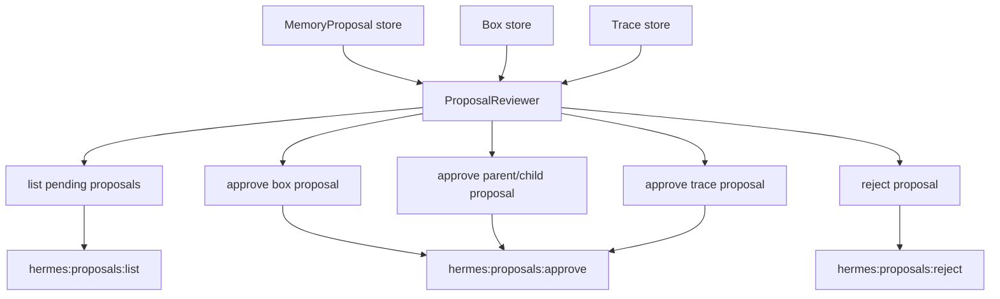

# Proposal Review Commands Design

## Purpose

Add the host-facing review surface for sleep-review proposals.

The current system can create and persist `MemoryProposal` records for proposed boxes, parent/child relationships, and traces. `hermes:sleep` returns proposal ids and proposed trace ids, but there is no command for an agent to inspect pending proposals or turn an accepted proposal into approved memory structure.

This phase adds command-based review rather than a dashboard:

- list pending proposals
- approve a proposal
- reject a proposal

The commands should be safe for a foreground agent to call while planning work. They should return compact structured JSON and avoid dumping full source history unless a later resume/search command is explicitly used.

## Product Goal

The agent should be able to ask:

- "What did sleep review find?"
- "Show pending memory organization proposals."
- "Approve the Smith PIP child box proposal."
- "Reject that overbroad trace."

Approving a proposal should promote only that proposal's intended structure. It should not auto-approve nearby proposals, mutate unrelated boxes, or infer extra relationships.

## Current Baseline

Implemented:

- `MemoryProposalSchema`
- `MemoryTraceSchema`
- typed payload schemas for `box`, `box_parent_child`, and `trace`
- `MemoryStore.saveProposal`
- `MemoryStore.listProposals`
- `MemoryStore.saveTrace`
- `MemoryStore.listTraces`
- deterministic sleep planning that persists proposed records
- `hermes:sleep` output with `proposalIds` and `proposedTraceIds`

Missing:

- proposal lookup by id
- command to list proposals in a review-friendly shape
- command to approve proposal payloads
- command to reject proposals
- transactional approval semantics for parent/child and trace proposals

## Design Principles

1. Approval is explicit.
2. Rejection is non-destructive.
3. Approval mutates only the durable structure described by the proposal payload.
4. Approved boxes, traces, and proposals keep provenance back to summary ids and turn ranges.
5. Parent/child approval must not create dangling references.
6. Trace approval must persist a `MemoryTrace`.
7. Commands return compact JSON by default.
8. Listing should support filters so agents can ask for pending work without loading everything.
9. Failed approvals should be clear and leave storage unchanged.
10. This phase stays command-based; no dashboard.

## Architecture

Add a proposal review service between storage and Hermes commands.



Core module:

- `src/proposals/proposal-reviewer.ts`

Hermes commands:

- `src/integrations/hermes/proposals-list-command.ts`
- `src/integrations/hermes/proposals-approve-command.ts`
- `src/integrations/hermes/proposals-reject-command.ts`

Package scripts:

- `hermes:proposals:list`
- `hermes:proposals:approve`
- `hermes:proposals:reject`

## ProposalReviewer

`ProposalReviewer` owns proposal review semantics.

Required methods:

```ts
listProposals(request: ProposalListRequest): Promise<ProposalListResult>;
approveProposal(request: ProposalDecisionRequest): Promise<ProposalApprovalResult>;
rejectProposal(request: ProposalDecisionRequest): Promise<ProposalRejectionResult>;
```

### List

List should support:

- state filter, default `proposed`
- proposal type filter
- limit, default 20
- include payload, default false

List result should include compact proposal summaries:

- `id`
- `proposalType`
- `state`
- `title`
- `rationale`
- `confidence`
- `createdAt`
- `reviewedAt`
- `sourceSummaryIds`
- `targetBoxIds`
- `targetTraceIds`
- optional `payload`

### Approve

Approval request:

- `proposalId`
- `decidedAt`
- optional `reviewer`
- optional `note`

Approval result:

- `ok: true`
- `proposalId`
- `proposalType`
- `approvedAt`
- `createdBoxIds`
- `updatedBoxIds`
- `createdTraceIds`
- `updatedProposalIds`

### Reject

Rejection request:

- `proposalId`
- `decidedAt`
- optional `reviewer`
- optional `note`

Rejection result:

- `ok: true`
- `proposalId`
- `proposalType`
- `rejectedAt`
- `updatedProposalIds`

Rejected proposals remain stored with `state: rejected`.

## Approval Semantics

### Box Proposal

Approving a `box` proposal:

1. Parse `BoxProposalPayloadSchema`.
2. Require proposal state `proposed`.
3. Upsert the target `Box` as `approved`.
4. Preserve payload summary ids and turn ranges.
5. Use `candidateParentBoxId` only as a field on the approved box when that parent exists. Do not update the parent's `childBoxIds` here unless a matching parent/child proposal is approved.
6. Mark the proposal `approved`.

This separates "create this box" from "wire it into a hierarchy."

### Parent/Child Proposal

Approving a `box_parent_child` proposal:

1. Parse `ParentChildProposalPayloadSchema`.
2. Require proposal state `proposed`.
3. Require parent box exists.
4. Require child box exists.
5. Set child `parentBoxId` to parent.
6. Add child id to parent `childBoxIds` if absent.
7. Mark the proposal `approved`.

If either box is missing, fail without mutation. The agent can approve the related box proposal first.

### Trace Proposal

Approving a `trace` proposal:

1. Parse `TraceProposalPayloadSchema`.
2. Require proposal state `proposed`.
3. Create or upsert `MemoryTrace` with `state: approved`.
4. Preserve summary ids, box ids, turn ranges, confidence, and rationale.
5. Mark the proposal `approved`.

Trace approval does not mutate boxes. Later retrieval can use traces once retrieval support is explicitly added.

## Command Contracts

All commands follow existing Hermes command style:

- accepts `--db` or `HERMES_CONVERSATIONAL_MEMORY_DB`
- reads JSON from stdin
- writes pretty JSON to stdout
- writes errors to stderr and exits nonzero

### `hermes:proposals:list`

Input:

```json
{
  "state": "proposed",
  "proposal_type": "box",
  "limit": 20,
  "include_payload": false
}
```

All fields optional.

Output:

```json
{
  "ok": true,
  "proposals": [
    {
      "id": "proposal_box_box_topic_smith_pip",
      "proposalType": "box",
      "state": "proposed",
      "title": "Smith PIP",
      "rationale": "2 summaries share smith, pip.",
      "confidence": 0.75,
      "sourceSummaryIds": ["summary_1", "summary_2"],
      "targetBoxIds": ["box_topic_smith_pip"],
      "targetTraceIds": []
    }
  ],
  "count": 1
}
```

### `hermes:proposals:approve`

Input:

```json
{
  "proposal_id": "proposal_box_box_topic_smith_pip",
  "decided_at": "2026-05-07T14:00:00.000Z",
  "reviewer": "aaron",
  "note": "Looks right."
}
```

Output:

```json
{
  "ok": true,
  "proposalId": "proposal_box_box_topic_smith_pip",
  "proposalType": "box",
  "approvedAt": "2026-05-07T14:00:00.000Z",
  "createdBoxIds": ["box_topic_smith_pip"],
  "updatedBoxIds": [],
  "createdTraceIds": [],
  "updatedProposalIds": ["proposal_box_box_topic_smith_pip"]
}
```

### `hermes:proposals:reject`

Input:

```json
{
  "proposal_id": "proposal_trace_trace_smith_pip_provider_bill",
  "decided_at": "2026-05-07T14:00:00.000Z",
  "reviewer": "aaron",
  "note": "Too broad."
}
```

Output:

```json
{
  "ok": true,
  "proposalId": "proposal_trace_trace_smith_pip_provider_bill",
  "proposalType": "trace",
  "rejectedAt": "2026-05-07T14:00:00.000Z",
  "updatedProposalIds": ["proposal_trace_trace_smith_pip_provider_bill"]
}
```

## Storage Requirements

The current store can list proposals but cannot look up one proposal directly. This phase can either:

- add `getProposal(id)` and `getBox(id)` helper methods to `MemoryStore`, or
- implement lookup by listing and filtering.

Recommendation: add explicit lookup methods because approval needs clear not-found behavior and avoids repeated list scans.

Add:

- `getProposal(id): Promise<MemoryProposal | null>`
- `getBox(id): Promise<Box | null>`
- `getTrace(id): Promise<MemoryTrace | null>`

These are additive and safe for existing storage.

## Decision Metadata

This phase should not redesign `MemoryProposalSchema`. To record review metadata without broad schema churn, update proposal state and encode review metadata in the proposal payload under:

```json
{
  "decision": {
    "decidedAt": "2026-05-07T14:00:00.000Z",
    "reviewer": "aaron",
    "note": "Looks right."
  }
}
```

The payload must still satisfy the proposal-type payload schema. Therefore decision metadata should be stored at the top-level proposal only if the schema is extended, or in a future `decision` field. Recommendation: extend `MemoryProposalSchema` with nullable `decidedAt`, `decidedBy`, and `decisionNote` fields. Existing proposal builders should set them to `null`.

Required additions:

- `decidedAt: IsoDateTimeSchema.nullable()`
- `decidedBy: z.string().min(1).nullable()`
- `decisionNote: z.string().nullable()`

## Testing Strategy

Tests should cover:

- list filters proposed proposals by default
- list can include payloads on request
- approving a box proposal creates/updates an approved box and approves the proposal
- approving a parent/child proposal updates both parent and child boxes
- parent/child approval fails when parent or child is missing
- approving a trace proposal creates an approved trace and approves the proposal
- rejecting a proposal marks it rejected and does not mutate boxes/traces
- approving/rejecting missing proposals throws a clear error
- approving already approved/rejected proposals throws a clear error
- Hermes commands parse stdin, return compact JSON, and close SQLite stores

## Compatibility

Existing proposals created before this phase will not have decision fields. To keep compatibility:

- schema migration should accept missing decision fields by defaulting them to `null`, or tests should migrate builders and existing records are considered development-only.
- command logic should tolerate proposals with absent decision fields if older JSON payloads are present.

Because this repository is still pre-production and proposal records were just introduced, adding required nullable fields is acceptable if tests and builders are updated consistently.

## Out of Scope

This phase does not add:

- dashboard UI
- automatic approval
- retrieval ranking over approved traces
- bulk approve/reject
- merge/split proposals
- contradiction/supersession review
- OpenRouter review judgments

## Success Criteria

This phase is complete when:

1. Agents can list pending proposals through a Hermes command.
2. Agents can approve box proposals.
3. Agents can approve parent/child proposals.
4. Agents can approve trace proposals.
5. Agents can reject proposals without deleting them.
6. Approval/rejection commands are deterministic and tested.
7. Full tests and typecheck pass.
