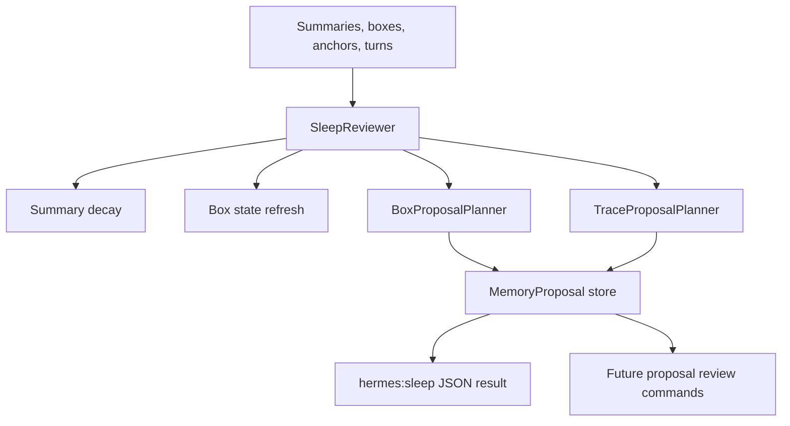

# Sleep Review and Trace Planning Design

## Purpose

Build the next major phase of the accordion memory system as a planned background organization pipeline, not as isolated incremental slices.

The current system can ingest Hermes timeline rows, compact completed topics, retrieve and inject relevant memory, resume verbatim source turns, decay summaries, refresh box states, and run a first deterministic `hermes:sleep` command. The weak point is structural intelligence: proposed boxes are shallow, there is no trace/link layer, and sleep review cannot yet explain proposed organization changes in the richer "memory librarian" sense.

This phase turns sleep review into the place where the system proposes durable organization:

- richer topic/case/project boxes
- candidate parent/child box structure
- non-contiguous trace links across long-running subjects
- auditable proposal records
- deterministic behavior first
- optional OpenRouter-backed planning later behind the same contracts

The system should remain standalone and host-agnostic. Roscoe-Hermes is the first adapter target, but the design must not make this a Hermes-only feature.

## Current Baseline

Implemented baseline:

- `Turn`, `Summary`, `Box`, `Anchor`, and `InjectionPacket` domain schemas
- append-only turn storage
- JSON payload persistence in SQLite
- topic monitoring and control-signal compaction
- deterministic and OpenRouter summarizer support
- deterministic anchor detection
- retrieval injection with keyword/vector ranking
- injection source deduplication
- resume expansion from summaries and injection packets
- `hermes:ingest`, `hermes:inject`, `hermes:resume`, and `hermes:sleep`
- `SleepReviewer.decaySummaries`
- `SleepReviewer.refreshBoxStates`
- basic `SleepReviewer.proposeBoxes`

Existing limitation:

`SleepReviewer.proposeBoxes` groups summaries by the first two significant words. That made the first sleep loop testable, but it is not good enough for legal case memory, project continuity, nested boxes, or recurring subtopics.

## Product Goal

The background reviewer should behave like an organized legal assistant reviewing the file overnight:

- notice that multiple summaries belong together
- notice when a subject is a child branch of a larger case/project
- notice when a later conversation continues the same issue from an earlier conversation
- preserve exact source provenance
- propose changes rather than silently rewriting approved structure
- keep explanations compact enough for the foreground agent to use

For example:

- Parent box: `Smith v. Jones`
- Child box: `Smith PIP Coverage`
- Child box: `Smith BI Coverage`
- Trace: `Smith PIP provider bill review` continues across summaries from turn ranges `1-30`, `4350-4380`, and a later resumed conversation

The system should distinguish:

- same case
- same topic
- same continuing issue
- sibling subtopics under a parent
- duplicate proposals
- superseded or conflicting facts

Only the first three are in this phase. Duplicate detection is included only enough to avoid obvious duplicate proposals. Supersession/conflict handling should be designed around, but not fully implemented here.

## Design Principles

1. Proposals are not approvals.
2. Every proposal must preserve source summary ids and source turn ranges.
3. The deterministic planner is the default and the test oracle.
4. LLM planning is optional and must return validated structured data.
5. Same client or case is not enough to create a trace; a trace must continue the same activity, issue, plan, or factual development.
6. Durable proposal text should avoid relative dates such as "today" or "recently".
7. The storage contract should support future Graphiti-style entities and facts without requiring a graph database now.
8. The host command surface should stay small: sleep, list proposals, approve/reject later.
9. Legal/high-stakes details should prefer under-merging to over-merging.
10. Existing approved boxes should not be rewritten automatically by sleep review.

## Architecture

This phase adds a proposal layer between raw sleep analysis and approved memory structure.



The `SleepReviewer` remains the orchestration point. It should not become a large reasoning class. It delegates:

- decay to existing decay logic
- box state refresh to existing refresh logic
- richer box planning to `BoxProposalPlanner`
- trace/link planning to `TraceProposalPlanner`
- proposal persistence to the store

## New Domain Concepts

### MemoryProposal

`MemoryProposal` is an auditable pending recommendation from the background reviewer.

It should be able to represent proposed boxes, parent-child relationships, traces, merges, and future supersession/dispute proposals. This phase implements box and trace proposal kinds first.

Required fields:

- `id`
- `proposalType`
- `state`
- `title`
- `rationale`
- `confidence`
- `createdAt`
- `reviewedAt`
- `sourceSummaryIds`
- `sourceTurnRanges`
- `targetBoxIds`
- `targetTraceIds`
- `payload`

Required enums:

- `proposalType`: `box`, `box_parent_child`, `trace`
- `state`: `proposed`, `approved`, `rejected`, `superseded`

`payload` is a typed JSON object whose schema depends on `proposalType`.

Why a separate proposal object:

- It avoids bloating approved `Box` records with planner-only metadata.
- It allows the system to explain what sleep review found without mutating durable structure.
- It creates a clean review/approval surface later.
- It can support future merge/split/supersession proposals without redesigning storage.

### MemoryTrace

`MemoryTrace` is a lightweight link chain across summaries or boxes.

It is not a full graph database. It is a first-class local record that says: these memory objects continue the same issue/activity/factual development across time.

Required fields:

- `id`
- `title`
- `description`
- `traceType`
- `state`
- `summaryIds`
- `boxIds`
- `turnRanges`
- `createdAt`
- `updatedAt`
- `lastActivityAt`
- `confidence`
- `rationale`

Required trace types:

- `case_issue`
- `task_thread`
- `strategy_thread`
- `fact_development`
- `follow_up`

Only proposed traces are created in the core implementation phase. Approval behavior is a separate follow-up surface: approving a trace proposal must persist a `MemoryTrace` record and mark the proposal as `approved` in the same transaction.

### Box Proposal Payload

A box proposal payload should include:

- `boxId`
- `title`
- `description`
- `summary`
- `boxType`
- `candidateParentBoxId`
- `keywords`
- `evidence`
- `sourceSummaryIds`
- `sourceTurnRanges`

`evidence` should be compact structured text, such as:

- overlapping keywords
- shared anchors
- non-contiguous source ranges
- similar existing box title
- inferred legal/case topic label

### Parent/Child Proposal Payload

A parent/child proposal should not directly rewrite `parentBoxId` or `childBoxIds`.

It should include:

- `parentBoxId`
- `childBoxId`
- `relationshipLabel`
- `rationale`
- `sourceSummaryIds`

The child can be either an existing box or a proposed box id.

### Trace Proposal Payload

A trace proposal should include:

- `traceId`
- `title`
- `description`
- `traceType`
- `summaryIds`
- `boxIds`
- `turnRanges`
- `continuityReason`
- `boundaryReason`
- `keywords`

`continuityReason` explains why these objects belong in the same trace.

`boundaryReason` explains why nearby related objects were not included. This encourages conservative grouping.

## Planner Interfaces

The deterministic and LLM planners should share interfaces.

```ts
export interface BoxProposalPlanner {
  proposeBoxes(request: BoxProposalPlanningRequest): Promise<BoxProposalPlanningResult>;
}

export interface TraceProposalPlanner {
  proposeTraces(request: TraceProposalPlanningRequest): Promise<TraceProposalPlanningResult>;
}
```

Planning requests should include:

- `reviewedAt`
- `summaries`
- `boxes`
- `anchors`
- existing `proposals`
- optional thresholds

Planning results should include:

- proposed boxes as `MemoryProposal[]`
- proposed parent/child relationships as `MemoryProposal[]`
- proposed traces as `MemoryProposal[]`
- skipped candidates with reasons when useful for tests/debugging

The deterministic planners should live in focused modules, not inside `sleep-reviewer.ts`.

Recommended file layout:

- `src/proposals/memory-proposal.ts`
- `src/proposals/proposal-dedupe.ts`
- `src/boxes/box-proposal-planner.ts`
- `src/traces/trace-proposal-planner.ts`
- `src/sleep/sleep-reviewer.ts`

## Deterministic Box Planning

The deterministic planner should improve the current first-two-token grouping without pretending to be a complete legal reasoning system.

Signals:

- significant keyword overlap
- shared normalized legal/case terms
- shared anchors
- source ranges from the same thread separated by a meaningful gap
- existing box title/summary overlap
- summary `boxIds`

The first deterministic version should:

1. Normalize summary text into significant terms.
2. Build candidate clusters from summaries with enough term overlap.
3. Score each cluster.
4. Reject clusters that are too small or too low confidence.
5. Reject obvious duplicates of existing active/approved/proposed boxes.
6. Generate a proposed box payload.
7. Generate parent-child proposals when a candidate is more specific than an existing box.

Specificity can start simple:

- child candidate title contains parent title terms plus additional terms
- child candidate shares at least one existing parent box summary id or source thread
- child candidate has narrower keywords than the parent

The planner should be conservative. A weak parent-child signal should leave the proposal flat.

## Deterministic Trace Planning

The trace planner should link memory across non-contiguous spans when there is evidence of continuity.

Signals:

- summaries share high-value terms and at least one more specific term than the case/client name
- summaries are separated in source ranges or creation time
- anchors overlap by topic, deadline, decision, or key fact
- boxes share a likely parent, but are not merely broad siblings
- summary text suggests continuation: follow-up, deadline, response, bill review, provider, demand, coverage issue, strategy update

The first deterministic version should:

1. Build candidate summary pairs or small clusters.
2. Exclude adjacent summaries that are already covered by the same compacted span unless they recur later.
3. Score continuity using keyword, anchor, and time-gap signals.
4. Require at least one continuity signal beyond same case/client words.
5. Produce trace proposals with explicit continuity and boundary reasons.

Trace planning should not approve traces automatically.

## OpenRouter Planning

This phase should create room for an LLM planner, but it should not depend on it.

Recommended approach:

- define planner interfaces now
- implement deterministic planners now
- optionally add `OpenRouterBoxProposalPlanner` and `OpenRouterTraceProposalPlanner` in a later phase
- validate every LLM response with Zod before storing it
- reject malformed or overbroad proposals instead of partially accepting them

The LLM prompt should draw from Letta, MemBox, and Graphiti patterns:

- treat the planner as a background reviewer
- operate on bounded summaries and anchors, not the full transcript by default
- return no proposals when nothing meaningful changed
- distinguish duplicate, related, and same-continuing-issue
- preserve absolute dates and source ids
- explain why excluded nearby candidates were not included

## Storage

The `MemoryStore` interface should grow deliberately.

Needed additions:

- `saveProposal(proposal)`
- `listProposals(filter?)`
- `saveTrace(trace)`
- `listTraces(filter?)`

SQLite can continue using JSON payload tables for this phase:

- `proposals(id text primary key, state text, proposal_type text, payload text not null)`
- `traces(id text primary key, state text, payload text not null)`

Indexes should support:

- proposals by state and type
- traces by state

This keeps the local-first SQLite approach while leaving room for normalized tables later.

## Sleep Command Behavior

`hermes:sleep` should remain the main host-facing command for background review.

Input should keep current fields:

- `reviewed_at`
- `minimum_summaries_per_box`
- `stale_strength_threshold`

Add optional planning controls:

- `include_proposals`
- `proposal_mode`
- `minimum_trace_summaries`
- `minimum_box_confidence`
- `minimum_trace_confidence`

`proposal_mode` values:

- `deterministic`
- `llm`
- `hybrid`

For this phase, `deterministic` is implemented. `llm` and `hybrid` may be accepted only if implemented; otherwise the command should fail clearly or fall back only when explicitly configured to do so.

Output should include:

- `updatedSummaryIds`
- `updatedBoxIds`
- `proposedBoxIds`
- `proposalIds`
- `proposedTraceIds`
- `noopReason`

The command should not dump large proposal bodies by default. It should return ids and counts. Future list/review commands can inspect full proposals.

## Proposal Review Surface

This phase should not build a dashboard.

The useful host surface is command-based:

- list pending proposals
- approve proposal
- reject proposal

Those commands should be planned after proposal persistence exists. They are not required for the core deterministic planner tasks, but the storage and schema design must support them cleanly.

Foreground agents should be able to ask:

- "What did sleep review find?"
- "Show pending memory organization proposals."
- "Approve this proposed box."

The user does not need a morning dashboard by default.

## Testing Strategy

Tests should be deterministic and domain-specific.

Core tests:

- proposal schemas accept valid records and reject invalid records
- SQLite persists proposals and traces
- deterministic box planner proposes one Smith PIP child box from repeated Smith PIP summaries
- deterministic box planner does not merge Smith PIP and Smith BI into one child box
- deterministic box planner avoids duplicate proposals when an approved or pending box already exists
- parent-child planner proposes Smith PIP under Smith case when the parent exists
- trace planner links non-contiguous Smith PIP bill review summaries
- trace planner does not link summaries that only share the broad Smith case term
- `SleepReviewer` stores proposals and returns changed ids
- `hermes:sleep` returns proposal ids without large proposal payloads

Regression tests:

- existing summary decay behavior remains unchanged
- existing box state refresh behavior remains unchanged
- current `hermes:sleep` no-op behavior remains stable when no proposals exist
- existing retrieval and resume tests continue to pass

## Migration and Compatibility

This phase can add store methods and SQLite tables without breaking existing data because current tables use JSON payloads and migration is additive.

Existing `Box` records should remain valid.

Existing `SleepReviewer.proposeBoxes` behavior can be replaced behind the same method name or split into a new method, but public command output should remain backward compatible by keeping `proposedBoxIds`.

If proposal tables do not exist, `SqliteStore` migration should create them automatically.

## Out of Scope

Do not build these in this phase:

- full graph database integration
- memory dashboard
- automatic approval of structural proposals
- destructive merge/split of existing approved boxes
- contradiction/supersession engine
- per-turn LLM extraction
- mandatory OpenRouter sleep planner
- cross-device sync
- production daemon scheduling

The design should leave space for these later, but the implementation plan should keep this phase focused.

## Success Criteria

This phase is successful when:

1. Sleep review produces richer proposed boxes than first-two-token grouping.
2. Proposed boxes include evidence, rationale, confidence, source summaries, and source ranges.
3. Parent/child structure can be proposed without mutating approved boxes.
4. Non-contiguous traces can be proposed for recurring issue threads.
5. Overbroad trace links are rejected by deterministic tests.
6. Proposals persist in SQLite and can be listed by store methods.
7. `hermes:sleep` reports proposal ids cleanly.
8. The full existing test suite remains green.

## Implementation Plan Boundary

The implementation plan should be written as a single coherent plan with ordered tasks and commit boundaries.

Recommended task order:

1. Add proposal and trace domain schemas.
2. Add store support for proposals and traces.
3. Add deterministic `BoxProposalPlanner`.
4. Wire box proposals into `SleepReviewer`.
5. Add parent/child proposal generation.
6. Add deterministic `TraceProposalPlanner`.
7. Extend `SleepReviewer` and `hermes:sleep` output for trace/proposal ids.
8. Add ADRs and update smoke harness docs if command output or env contracts change.

OpenRouter-backed planning should be a follow-up phase unless the user explicitly expands this phase after the deterministic implementation plan is reviewed.
