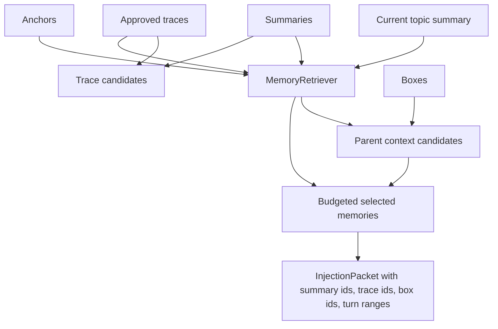

# Trace-Aware Retrieval and Box Hierarchy Recall Design

## Purpose

Approved traces and approved box relationships should affect memory injection.

The current retrieval path can find summaries and anchors, but it ignores the durable structure created by sleep review and proposal approval. That means the system can approve a trace such as "Smith PIP provider bill dispute" and still fail to use that trace when the foreground agent asks about the issue later.

This phase makes retrieval aware of:

- approved `MemoryTrace` records
- child boxes selected by summary, anchor, or trace matches
- bounded parent box context when a child issue is selected

The result should feel like opening the right nested folder: the agent gets the specific issue thread first, then a small amount of parent case context when it helps.

## Product Goal

The agent should be able to resume a recurring issue thread without loading the entire case.

Examples:

- "Let's pick up Smith PIP provider bills."
- "What were we doing on the no-fault wage loss issue?"
- "Go back to the provider bill dispute in the Smith matter."

The injection packet should explain why memory was selected:

- top trace match
- linked source summaries
- included parent box context
- token-budget packing

Trace-aware retrieval should not turn every broad parent case into always-on context. A query about a specific PIP issue may include the Smith case parent summary; a query that only says "Smith case" should not blindly inject every Smith child trace.

## Current Baseline

Implemented:

- `MemoryTraceSchema`
- approved trace persistence
- approved parent/child box relationships
- proposal review commands
- summary and anchor retrieval
- retrieval strengthening and stale-summary revival
- injection audit packets

Missing:

- trace candidates in retrieval ranking
- auditable trace ids on injection packets
- parent box context selection
- relevance and disclosure text for trace and hierarchy matches
- tests preventing broad parent over-injection

## Design Principles

1. Specific issue threads beat broad parent context.
2. Approved traces are eligible; proposed, rejected, and superseded traces are ignored.
3. Parent box context is bounded and secondary.
4. Injection packets should include trace provenance, not just free-text explanation.
5. Existing summary strengthening and revival behavior remains summary-scoped.
6. Deterministic ranking stays the default; OpenRouter is not part of this phase.
7. Token budgets are respected before convenience context is added.
8. Retrieval should be explainable from local stored fields.
9. The implementation should stay in the retrieval boundary, with helper functions split only where they reduce complexity.

## Architecture

Extend `MemoryRetriever` from a two-source ranker into a structured candidate ranker.



The retrieval flow becomes:

1. Load summaries, anchors, approved traces, and boxes.
2. Rank summaries and anchors using current scoring rules.
3. Build compact trace candidates from approved traces and linked summaries.
4. Rank trace candidates with stricter specificity rules than summary ranking.
5. Select the strongest specific candidates under the token budget.
6. Add parent box context only for selected child boxes when it fits the remaining budget.
7. Persist the injection packet and update selected source summaries.

## Trace Candidates

A trace candidate is a compact memory item built from the durable trace plus linked summaries.

Candidate text format:

```text
[Trace: Smith PIP Provider Bills]
Smith PIP provider bill dispute and no-fault payment timing.
Linked summaries:
- Smith PIP demand strategy and provider bill review.
- Provider ledger still needed before demand finalization.
Rationale: Recurring issue across separate conversation spans.
```

Candidate metadata:

- `kind: "trace"`
- `id: trace.id`
- `traceId: trace.id`
- `summaryIds: trace.summaryIds`
- `sourceTurnRanges: trace.turnRanges`
- `boxIds: trace.boxIds`
- `canUseStub: true`

Only traces with `state: "approved"` are eligible.

Trace ranking uses keyword overlap for this phase. A trace should rank only when at least two non-broad query words overlap the trace title, description, rationale, keywords, or linked summaries.

This avoids selecting a trace just because both the query and trace mention a broad word like "Smith" or "case."

## Parent Box Context

Parent context is not a top-level search result. It is follow-on context after a child-specific memory is selected.

Parent context is eligible when:

- a selected memory has a child `boxId`
- that box has `parentBoxId`
- the parent box exists
- the parent state is `active`, `approved`, or `revived`
- the parent context fits the remaining token budget

Parent context text format:

```text
[Parent Box: Smith Case]
Smith car accident matter involving PIP, BI, and provider billing issues.
```

Parent context metadata:

- `kind: "box_context"`
- `id: parentBox.id`
- `summaryId: null`
- `traceId: null`
- `sourceTurnRanges: parentBox.turnRanges`
- `boxIds: [parentBox.id]`
- `canUseStub: false`

Parent context does not revive or strengthen summaries by itself. If a selected trace includes linked summaries, those summaries still get normal access metadata updates.

## Injection Packet Changes

Add `sourceTraceIds` to `InjectionPacketSchema`:

```ts
sourceTraceIds: z.array(z.string().min(1))
```

All injection packets will include the field. Existing builders and tests should use `[]` when no traces were selected. This makes trace provenance auditable without parsing `selectedMemory` or `relevanceReason`.

Existing fields keep their meaning:

- `sourceSummaryIds`: summary ids directly selected or linked by selected traces
- `sourceTurnRanges`: deduped ranges from selected summaries, traces, and parent context
- `boxIds`: selected child and parent box ids
- `relevanceReason`: compact top-match explanation
- `disclosureText`: compact context disclosure and budget note

## Ranking and Budgeting

The ranker should continue to select at most three primary memory items. Parent box context is allowed as a fourth item only when it fits the explicit token budget or when no budget was supplied.

Priority order:

1. ranked primary items: summary, trace, anchor
2. dedupe exact or covered anchors
3. select up to three primary items under budget
4. add parent box context using leftover budget

Tie-breaking remains deterministic:

```text
higher score first, then id ascending
```

When no explicit budget is supplied, parent context can be appended if one eligible parent exists. If multiple parents are eligible, include only the parent attached to the strongest selected child memory.

## Error Handling

Retrieval should be forgiving:

- missing linked summaries do not fail trace retrieval
- missing boxes skip parent context
- incompatible embeddings continue to fall back to keyword ranking
- empty trace lists behave like the current system

Schema validation should stay strict when persisting injection packets. Tests should catch any command or fixture that forgets `sourceTraceIds`.

## Testing Strategy

Add retrieval unit tests for:

- approved trace retrieval
- proposed/rejected trace ignored
- trace requires specific overlap
- trace selection includes source trace ids, summary ids, turn ranges, and box ids
- selected trace strengthens linked summaries
- child selection includes parent box context under budget
- parent context is omitted when budget is too small
- broad parent query does not inject unrelated child traces

Add integration coverage for `hermes:inject` showing a trace-aware relevance reason.

Update storage/injection fixtures for `sourceTraceIds`.

## Out of Scope

This phase does not implement:

- vector embeddings for traces
- LLM-based trace retrieval judgment
- automatic trace approval
- dashboard or memory map UI
- verbatim turn expansion from selected traces
- cross-profile retrieval
- case-management system integrations

Those belong after deterministic retrieval can use the approved memory graph.

## Self-Review

- Placeholder scan: no incomplete sections or deferred requirements remain.
- Internal consistency: trace ids are explicit in injection packets; parent context stays secondary.
- Scope check: this is a single retrieval phase, not a sleep-planning or UI phase.
- Ambiguity check: trace eligibility, parent eligibility, and budget behavior are explicitly defined.
